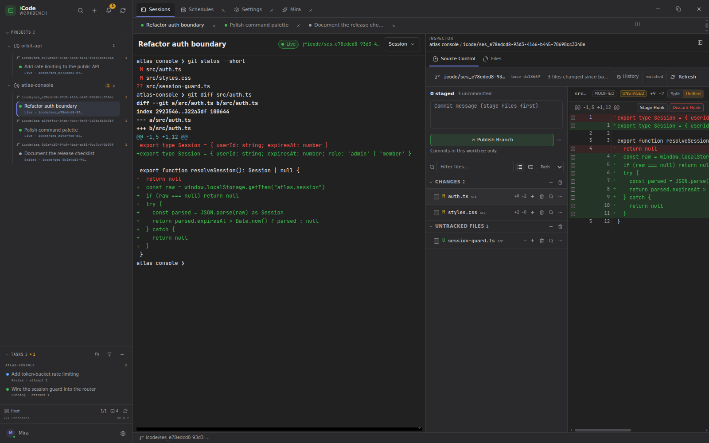

# iCode Workbench

<p align="center">
  <a href="README.md">English</a> ·
  <a href="README.zh-CN.md">简体中文</a> ·
  <a href="README.ja.md">日本語</a> ·
  <a href="README.ko.md">한국어</a> ·
  <a href="README.es.md">Español</a> ·
  <a href="README.pt-BR.md">Português (BR)</a> ·
  <strong>Deutsch</strong> ·
  <a href="README.fr.md">Français</a>
</p>

<h3 align="center">Jeder Agent. Jede Plattform. Eine Werkbank.</h3>

<p align="center">
  iCode Workbench ist die universelle Agent Development Environment (ADE): Claude Code,
  Codex und OpenCode laufen parallel, jeweils in einem eigenen Git-Worktree. Mira beobachtet
  alle Repositories, sagt dir, was deine Aufmerksamkeit braucht, und kann projektübergreifend
  handeln. Prüfe Änderungen dort, wo der Agent gearbeitet hat, und halte das Terminal am
  Leben, wenn die App neu startet.
</p>

<p align="center">
  
</p>

## Warum iCode Workbench?

- **Jeder Agent, eine Werkbank.** Heute: Claude Code, Codex und OpenCode; das
  Adaptermodell ist für weitere Harnesses ausgelegt.
- **Jede Plattform.** Linux (WSL2/WSLg), Windows x64 und macOS x64 / arm64.
- **Standardmäßig parallel.** Jede Sitzung erhält ihren eigenen Branch und Git-Worktree.
- **Mira über Projekte hinweg.** Eine Unterhaltung für Warteschlange, Blocker und
  projektübergreifende Aktionen.
- **Prüfen, wo der Agent gearbeitet hat.** Task-Diffs, Source Control und Monaco im
  selben Session-Checkout.
- **Alle Arbeit in einer Seitenleiste.** Projekte, direkte Sitzungen, angeheftete Elemente und die projektübergreifende Aufgabenwarteschlange bleiben sichtbar; Mira, Einstellungen und Zeitpläne öffnen als Tabs.

## Aktuell unterstützt

- **Agenten:** Claude Code, Codex, OpenCode
- **Plattformen:** Linux (WSL2/WSLg), Windows x64, macOS x64 / arm64

## Aus dem Quellcode bauen

```bash
git clone https://github.com/icodehq/icode-workbench.git
cd icode-workbench
corepack enable
pnpm install
pnpm dev
```

## Status

iCode Workbench befindet sich in einer frühen experimentellen Phase und wird schnell
weiterentwickelt. Funktionen, Speicherschemata und Paketierung können sich zwischen
Versionen ändern. Arbeite mit üblicher Git-Hygiene und lies vor einem Upgrade das
[Changelog](CHANGELOG.md).

> Dies ist eine übersetzte Übersicht. Das [englische README](README.md) ist die
> maßgebliche Quelle.

[English README](README.md) · [Mitwirken](.github/CONTRIBUTING.md) ·
[Sicherheit](SECURITY.md) · [Changelog](CHANGELOG.md)
