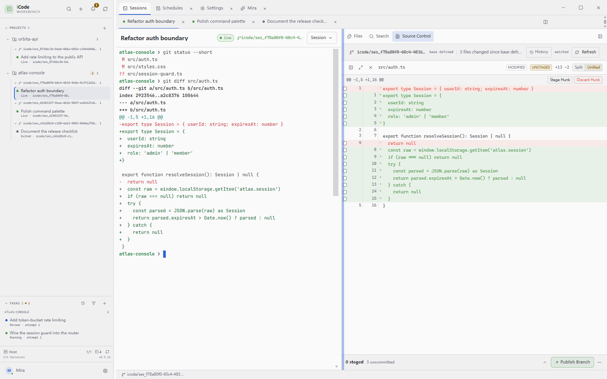
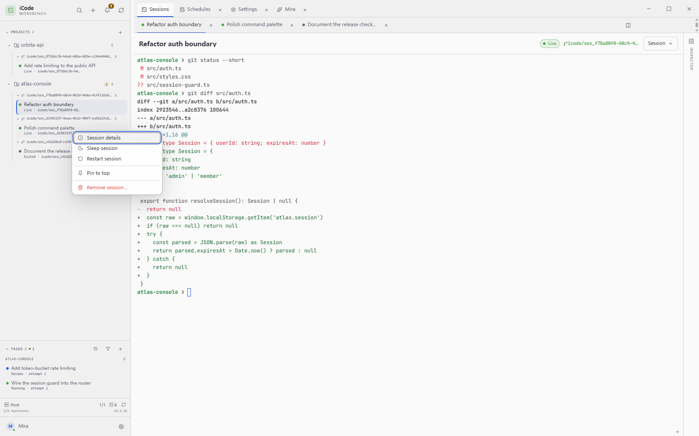

# iCode Workbench

<p align="center">
  <a href="README.md">English</a> ·
  <a href="README.zh-CN.md">简体中文</a> ·
  <a href="README.ja.md">日本語</a> ·
  <a href="README.ko.md">한국어</a> ·
  <strong>Español</strong> ·
  <a href="README.pt-BR.md">Português (BR)</a> ·
  <a href="README.de.md">Deutsch</a> ·
  <a href="README.fr.md">Français</a>
</p>

<h3 align="center">Todos los agentes. Todas las plataformas. Un solo banco de trabajo.</h3>

<p align="center">
  iCode Workbench es el entorno universal de desarrollo de agentes (ADE): ejecuta
  Claude Code, Codex y OpenCode en paralelo, cada uno en su propio worktree de Git.
  Mira observa todos los repositorios, te dice qué necesita tu atención y puede actuar
  entre proyectos. Revisa los cambios donde trabajó el agente y mantén la terminal viva
  cuando la aplicación se reinicia.
</p>

<p align="center">
  
</p>

## ¿Por qué iCode Workbench?

- **Todos los agentes, un solo banco de trabajo.** Hoy: Claude Code, Codex y OpenCode;
  el modelo de adaptadores está preparado para añadir más harness.
- **Todas las plataformas.** Linux (WSL2/WSLg), Windows x64 y macOS x64 / arm64.
- **Paralelo por defecto.** Cada sesión tiene su propia rama y worktree de Git.
- **Cada fila de sesión es un panel de control.** Haz clic derecho en una sesión para
  ver sus detalles, dormirla o despertarla, reiniciarla, fijarla o eliminarla sin
  abrirla. La eliminación no pide el nombre de la rama, nombra los cambios en riesgo
  y conserva la rama.
- **Mira entre proyectos.** Una conversación para la cola, los bloqueos y las acciones
  entre proyectos.
- **Revisión donde trabajó el agente.** Diffs de tareas, archivos, búsqueda y Source
  Control en el mismo checkout de la sesión.
- **Todo el trabajo en una barra lateral.** Proyectos, sesiones directas, elementos fijados y la cola de tareas entre proyectos siempre visibles; Mira, Ajustes y Programaciones se abren en pestañas.

<p align="center">
  <a href=".github/assets/workbench-0916-session-menu.png"></a>
</p>

*Cada fila de sesión lleva todo su ciclo de vida, incluso cuando la sesión no está abierta.*

## Compatibilidad actual

- **Agentes:** Claude Code, Codex, OpenCode
- **Plataformas:** Linux (WSL2/WSLg), Windows x64, macOS x64 / arm64

## Compilar desde el código fuente

```bash
git clone https://github.com/icodehq/icode-workbench.git
cd icode-workbench
corepack enable
pnpm install
pnpm dev
```

## Estado

iCode Workbench está en desarrollo experimental temprano y avanza rápidamente. Las
funciones, los esquemas de almacenamiento y el empaquetado pueden cambiar entre versiones.
Usa buenas prácticas de Git en trabajo real y consulta el
[registro de cambios](CHANGELOG.md) antes de actualizar.

> Esta es una traducción resumida. El [README en inglés](README.md) es la fuente autorizada.

[English README](README.md) · [Contribuir](.github/CONTRIBUTING.md) ·
[Seguridad](SECURITY.md) · [Registro de cambios](CHANGELOG.md)
