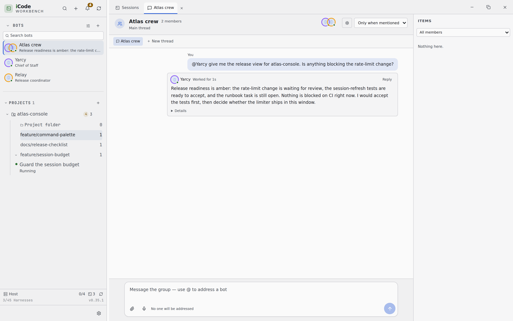
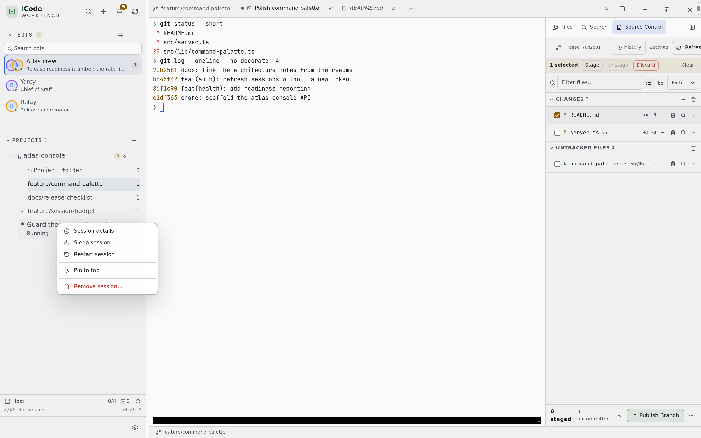

# iCode Workbench

<p align="center">
  <a href="README.md">English</a> ·
  <a href="README.zh-CN.md">简体中文</a> ·
  <strong>日本語</strong> ·
  <a href="README.ko.md">한국어</a> ·
  <a href="README.es.md">Español</a> ·
  <a href="README.pt-BR.md">Português (BR)</a> ·
  <a href="README.de.md">Deutsch</a> ·
  <a href="README.fr.md">Français</a>
</p>

<h3 align="center">すべてのエージェント。すべてのプラットフォーム。ひとつのワークベンチ。</h3>

<p align="center">
  iCode Workbench はマルチエージェントの開発環境です。44 個の起動可能な CLI
  エージェントが、それぞれ独立した Git ワークツリーで並列に動作します。Bot は
  プロジェクト、タスク、セッション、レビュー状態を把握し、あなたの対応が必要なことを
  伝えます。エージェントが作業したチェックアウトで変更をレビューし、アプリを再起動
  してもターミナルは生き続けます。
</p>

<p align="center">
  <strong>テレメトリーなし。アカウントなし。解析なし。</strong><br/>
  iCode はアプリ内でモデル API を呼びません。モデルとの通信はあなたの harness に
  属します。ハッシュ化するアカウントも、送信するデータもありません。
  <a href="PRIVACY.md">自分で確認する →</a>
</p>

<p align="center">
  
</p>

## iCode Workbench を選ぶ理由

- **44 個の起動可能な CLI エージェント。** 21 個は管理されたステータスフックに対応し、
  Claude Code、Codex、OpenCode はネイティブの provider 注入を使用できます。各
  エージェントは専用の Git ワークツリーで並列に動きます。
- **すべてのプラットフォーム。** Linux（WSL2/WSLg）、Windows x64、macOS x64 / arm64。
- **デフォルトで隔離。** 「新しい分離ワークスペース」から開始した直接セッションには、
  独自のブランチとワークツリーがあります。プロジェクトフォルダーはリポジトリの
  メイン checkout で、明示的に選んだ
  セッションだけが共有し、常に警告が表示されます。
- **ワークツリーがひとつのワークスペース。** タイトルバーのタブがターミナル、ファイル、
  diff をまとめて保持し、分割はネストできます。常設インスペクターには Files、Search、
  Source Control があります。
- **Bot はプロジェクトをまたいで動きます（公式テンプレート 25 個、Yarcy を含む）。**
  各 Bot は専用の Home Chat を持ち、スレッド、返信モード、@mention リレーを備えた
  グループルームにも参加できます。タスクの作成・キャンセル・再試行・アーカイブは
  できますが、レビューの承認、マージ、プッシュはできません。
- **エージェントが作業した場所でレビュー。** レビューの承認は判断を記録するだけで、
  コミット、マージ、プッシュ、削除は行いません。**Accept & merge…** は先に承認し、
  その後でマージピッカーを開き、マージを別の操作として確認します。
- **1 つのサイドバー、2 つの作業面。** Bots、ピン留めしたプロジェクト/セッション、
  Projects ツリーが 1 つのサイドバーに並び、needs-you ベルが横断キューになります。
  プロジェクトは Sessions ワークスペースまたはタスクワークベンチを開き、Bots、設定、
  スケジュールは補助タブで開きます。
- **ターミナルはアプリより長生きします。** 独立した host が PTY を保持するため、
  ウィンドウを閉じても iCode を終了してもエージェントは止まりません。
- **ローカルファースト。** 状態はローカルの SQLite に保存され、テレメトリーも
  ホスト型サービスもアプリ内のモデル呼び出しもありません。

<p align="center">
  <a href=".github/assets/workbench-1127-bots.png"></a>
</p>

*グループルーム：Bot を @ するとストリーミングで返信し、対応が必要な作業は隣の
Items レールに残ります。*

<p align="center">
  <a href=".github/assets/workbench-1127-session-menu.png"></a>
</p>

*セッションを開いていなくても、その行からライフサイクル全体を操作できます。*

## 現在の対応

- **起動可能なエージェント：** CLI エージェント 44 個（Claude Code、Codex、
  OpenCode を含む）。
- **ネイティブ provider 注入 + Bot 会話：** Claude Code、Codex、OpenCode。
- **管理されたステータスフック：** 21 個の harness。作業中、待機中、完了を
  サイドバーに表示します。
- **プラットフォーム：** Linux（WSL2/WSLg）、Windows x64、macOS x64 / arm64。

## ソースからビルド

**要件：** Node 24.x（`.nvmrc` は 24.15.0）、Corepack と pnpm 11.16.0、Git、
および `PATH` 上の少なくとも 1 つの harness。Linux では `build-essential` と
`python3`、macOS では Xcode Command Line Tools も必要です。

```bash
git clone https://github.com/icodehq/icode-workbench.git
cd icode-workbench
corepack enable
pnpm install
pnpm dev
```

## ステータス

iCode Workbench は初期実験段階にあり、急速に改善しています。機能、ストレージ
スキーマ、パッケージングはリリース間で変更される可能性があります。実際の作業では
通常の Git 運用を守り、アップグレード前に [変更履歴](CHANGELOG.md) を確認してください。

> これは翻訳された概要です。正式な情報は [English README](README.md) を参照してください。

[English README](README.md) · [コントリビューション](.github/CONTRIBUTING.md) ·
[セキュリティ](SECURITY.md) · [翻訳](TRANSLATIONS.md) · [変更履歴](CHANGELOG.md)
