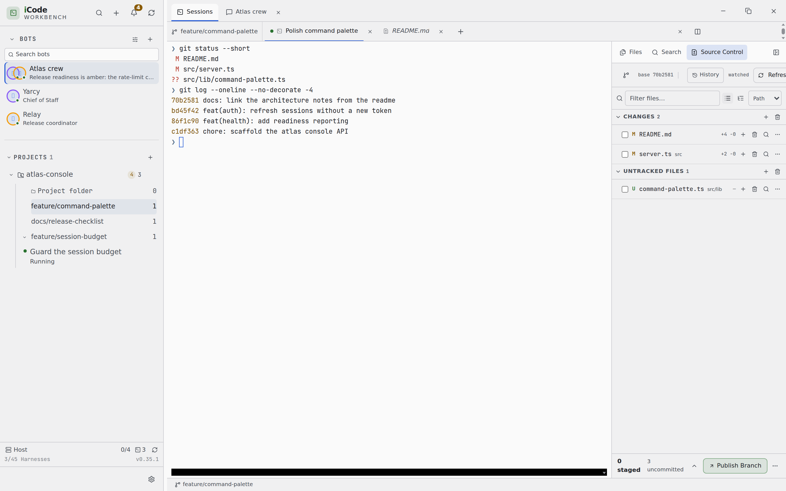

# iCode Workbench

<p align="center">
  <a href="README.md">English</a> ·
  <a href="README.zh-CN.md">简体中文</a> ·
  <a href="README.ja.md">日本語</a> ·
  <strong>한국어</strong> ·
  <a href="README.es.md">Español</a> ·
  <a href="README.pt-BR.md">Português (BR)</a> ·
  <a href="README.de.md">Deutsch</a> ·
  <a href="README.fr.md">Français</a>
</p>

<h3 align="center">모든 에이전트. 모든 플랫폼. 하나의 워크벤치.</h3>

<p align="center">
  iCode Workbench는 멀티 에이전트 개발 환경입니다. 44개의 실행 가능한 CLI
  에이전트가 각자의 독립된 Git 워크트리에서 병렬로 작업합니다. Bot은 프로젝트, 작업,
  세션, 리뷰 상태를 파악해 무엇이 필요한지 알려줍니다. 에이전트가 작업한 체크아웃에서
  변경 사항을 리뷰하고, 앱을 다시 시작해도 터미널은 계속 살아 있습니다.
</p>

<p align="center">
  <strong>텔레메트리 없음. 계정 없음. 분석 없음.</strong><br/>
  iCode는 앱 안에서 모델 API를 호출하지 않습니다. 모델 통신은 사용자의 harness에
  속합니다. 해시할 계정도, 보낼 데이터도 없습니다.
  <a href="PRIVACY.md">직접 확인하기 →</a>
</p>

<p align="center">
  
</p>

## iCode Workbench를 선택하는 이유

- **실행 가능한 CLI 에이전트 44개.** 그중 21개는 관리형 상태 훅을 지원하고,
  Claude Code·Codex·OpenCode는 네이티브 provider 주입을 사용합니다. 각 에이전트는
  전용 Git 워크트리에서 병렬로 실행됩니다.
- **모든 플랫폼.** Linux(WSL2/WSLg), Windows x64, macOS x64 / arm64.
- **기본이 격리.** 새 격리 워크스페이스에서 시작한 직접 세션은 자체 브랜치와
  워크트리를 받습니다. 프로젝트 폴더는 저장소의 기본 체크아웃이며, 명시적으로 선택한
  세션만 공유하고 항상 경고를 표시합니다.
- **워크트리가 하나의 워크스페이스.** 제목 표시줄의 탭이 터미널, 파일, diff를 함께
  담고 분할은 중첩됩니다. 상시 인스펙터에는 Files, Search, Source Control이 있습니다.
- **Bot은 프로젝트를 넘나듭니다(공식 템플릿 25개, Yarcy 포함).** 각 Bot은 전용
  Home Chat을 가지며 스레드, 답장 모드, @멘션 릴레이를 갖춘 그룹 룸에 참여할 수
  있습니다. 작업 생성·취소·재시도·보관은 가능하지만 리뷰 승인, 병합, 푸시는 할 수
  없습니다.
- **에이전트가 작업한 곳에서 리뷰.** 리뷰 승인은 판단만 기록하며 커밋, 병합, 푸시,
  삭제를 하지 않습니다. **Accept & merge…** 는 먼저 승인한 뒤 병합 선택기를 열어
  병합을 별도 작업으로 확인합니다.
- **하나의 사이드바, 두 개의 작업면.** Bots, 고정된 프로젝트/세션, Projects 트리가
  하나의 사이드바에 있고 needs-you 벨이 프로젝트 간 대기열을 엽니다. 프로젝트는
  Sessions 워크스페이스나 작업 워크벤치를 열고, Bots·설정·일정은 보조 탭으로
  열립니다.
- **터미널은 앱보다 오래 살아남습니다.** 독립 host가 PTY를 소유하므로 창을 닫거나
  iCode를 종료해도 에이전트는 멈추지 않습니다.
- **로컬 우선.** 상태는 로컬 SQLite에 저장되며 텔레메트리, 호스팅 서비스, 앱 내
  모델 호출이 없습니다.

<p align="center">
  <a href=".github/assets/workbench-1127-bots.png"></a>
</p>

*그룹 룸: Bot을 @하면 스트리밍으로 답하고, 소유자가 결정할 작업은 옆의 Items
레일에 남습니다.*

<p align="center">
  <a href=".github/assets/workbench-1127-session-menu.png"></a>
</p>

*세션이 열려 있지 않아도 그 행에서 전체 수명 주기를 제어할 수 있습니다.*

## 현재 지원

- **실행 가능한 에이전트:** CLI 에이전트 44개(Claude Code, Codex, OpenCode 포함).
- **네이티브 provider 주입 + Bot 대화:** Claude Code, Codex, OpenCode.
- **관리형 상태 훅:** harness 21개. 작업 중, 대기 중, 완료를 사이드바에 표시합니다.
- **플랫폼:** Linux(WSL2/WSLg), Windows x64, macOS x64 / arm64.

## 소스에서 빌드

**요구 사항:** Node 24.x(`.nvmrc`는 24.15.0), Corepack과 pnpm 11.16.0, Git,
그리고 `PATH`에 있는 하나 이상의 harness. Linux에는 `build-essential`과 `python3`,
macOS에는 Xcode Command Line Tools도 필요합니다.

```bash
git clone https://github.com/icodehq/icode-workbench.git
cd icode-workbench
corepack enable
pnpm install
pnpm dev
```

## 상태

iCode Workbench는 초기 실험 단계이며 빠르게 반복하고 있습니다. 기능, 저장소 스키마,
패키징 방식은 릴리스마다 바뀔 수 있습니다. 실제 작업에서는 일반적인 Git 습관을 지키고,
업그레이드 전에 [변경 로그](CHANGELOG.md)를 확인하세요.

> 이 문서는 번역된 개요입니다. 권위 있는 원문은 [English README](README.md)입니다.

[English README](README.md) · [기여하기](.github/CONTRIBUTING.md) ·
[보안](SECURITY.md) · [번역](TRANSLATIONS.md) · [변경 로그](CHANGELOG.md)
