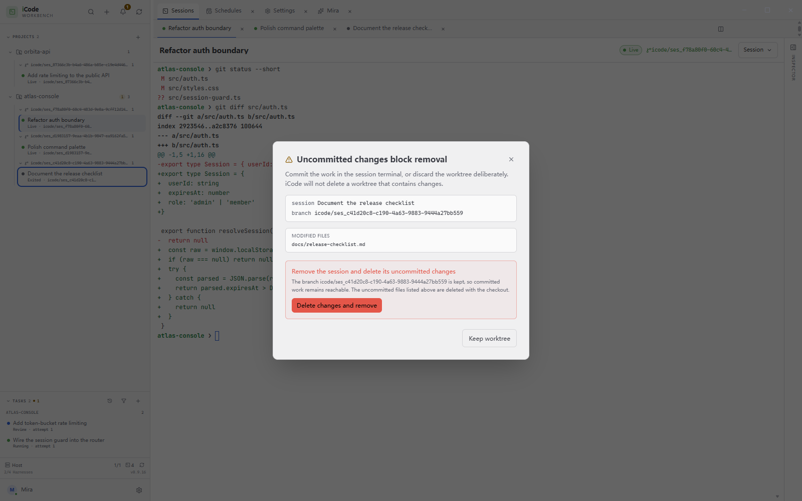
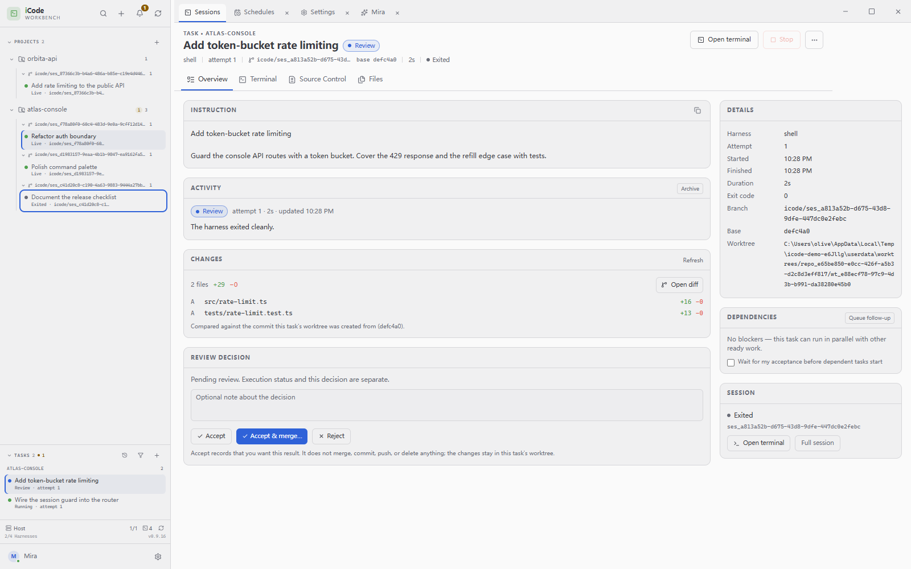
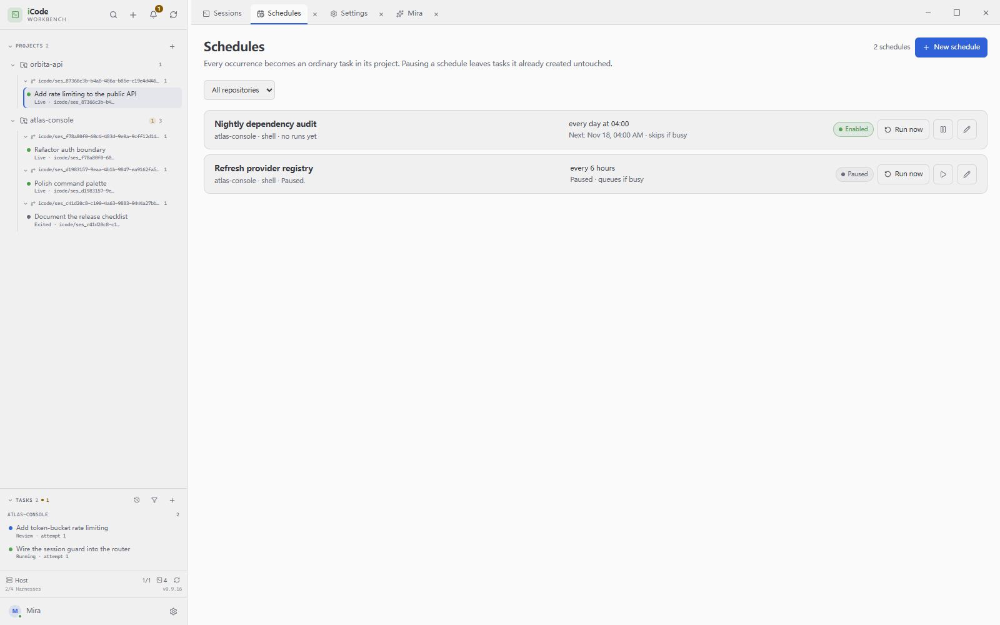
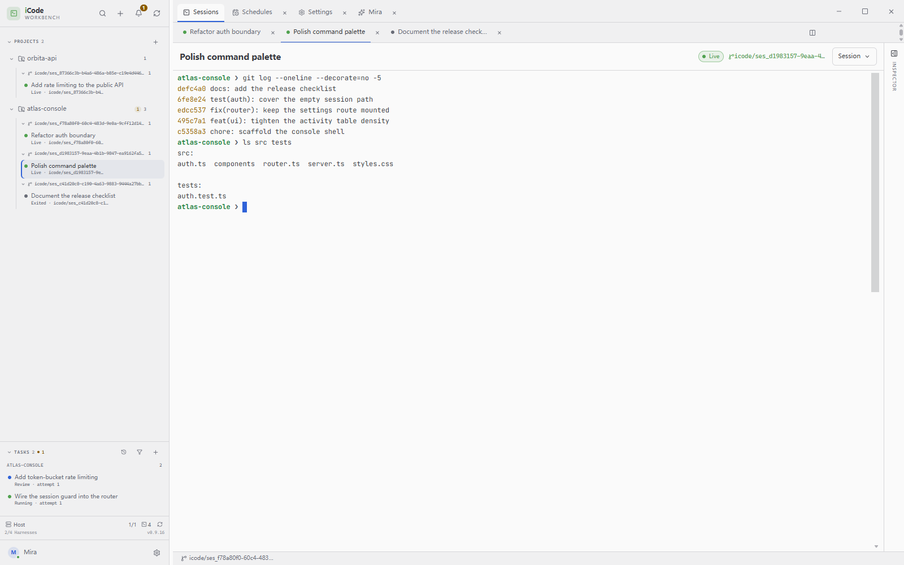
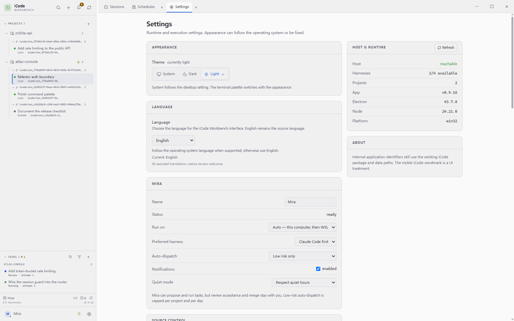

<h1 align="center">
   iCode Workbench
</h1>

<p align="center">
  <strong>English</strong> ·
  <a href="README.zh-CN.md">简体中文</a> ·
  <a href="README.ja.md">日本語</a> ·
  <a href="README.ko.md">한국어</a> ·
  <a href="README.es.md">Español</a> ·
  <a href="README.pt-BR.md">Português (BR)</a> ·
  <a href="README.de.md">Deutsch</a> ·
  <a href="README.fr.md">Français</a>
</p>

<p align="center">
  <a href="https://github.com/icodehq/icode-workbench/stargazers"></a>
  <a href="https://github.com/icodehq/icode-workbench/releases"></a>
  <a href="LICENSE"></a>
  
  
  
</p>

<p align="center">
  <strong>Run a fleet of agents. One workbench. Keep the judgment.</strong><br/>
  The open-source agent development environment for Claude Code, Codex, OpenCode, and 40+ more CLI agents.<br/>
  Isolated Git worktrees by default; every change reviewed in the checkout where it was made.
</p>

<p align="center">
  <strong>No telemetry. No account. No analytics.</strong><br/>
  T3 Code currently hashes your OpenAI and Claude account IDs and a stable install ID, then forwards them to PostHog by default.
  iCode has no account to hash — there is nothing to send. <a href="PRIVACY.md">Verify it →</a>
</p>

<h3 align="center">
  <a href="https://icodehq.vercel.app/workbench/#install"><ins>Download</ins></a> &nbsp;·&nbsp;
  <a href="https://icodehq.vercel.app/guides/"><ins>Guides</ins></a> &nbsp;·&nbsp;
  <a href="#features"><ins>Features</ins></a> &nbsp;·&nbsp;
  <a href="#supported-harnesses"><ins>Harnesses</ins></a> &nbsp;·&nbsp;
  <a href="CHANGELOG.md"><ins>Changelog</ins></a>
</h3>

<p align="center">
  
</p>

<p align="center">
  <sub>Pre-1.0 · Windows x64 · Linux x64 (WSL2/WSLg) · macOS x64 / arm64</sub>
</p>

## Privacy by default

iCode is local-first. The app itself collects **no analytics, no telemetry, no usage events, no account or install IDs, and no device IDs**. Prompts, code, file paths, and conversation IDs never leave your machine through iCode.

| Call | When | What leaves | Where |
|---|---|---|---|
| Update check | On launch and periodically | App version and platform in a standard update request | GitHub Releases |
| Agent CLI | When you run a harness | Whatever that CLI sends to its vendor and the provider you configured | Your CLI's vendor / your provider |
| Git | When you fetch or push | Repository data | The remote you configured |
| Diagnostics | Only when you choose to copy or export | Exactly what the view shows | Wherever you send it |

**T3 Code comparison:** T3 Code's telemetry docs (November 2026) describe hashed T3 Connect / OpenAI / Claude account IDs, a stable install ID, per-device IDs, and forwarding to PostHog — on by default, with an env-var opt-out. iCode has none of these: no account, no install ID, no analytics endpoint. [Side-by-side →](PRIVACY.md#how-t3-code-compares)

**Verify it:** [PRIVACY.md](PRIVACY.md) lists every outbound call; `scripts/audit-telemetry.sh` runs in CI and fails if an analytics SDK or endpoint is ever added.

**Policy:** iCode will never add telemetry. If that ever changes, it will be opt-in, off by default, and announced in the changelog.

## Start here

New to multi-agent workflows? These guides are the fastest path from one agent
to a fleet:

- [Parallel coding agents: the complete guide](https://icodehq.vercel.app/guides/parallel-agents/)
- [What is an agent development environment?](https://icodehq.vercel.app/guides/what-is-an-agent-development-environment/)
- [From one agent to a fleet](https://icodehq.vercel.app/guides/from-one-agent-to-a-fleet/)
- [Git worktrees for coding agents](https://icodehq.vercel.app/guides/agent-worktrees-explained/)
- [How to queue coding agent tasks](https://icodehq.vercel.app/guides/queue-coding-agent-tasks/)
- [How to review AI-generated code](https://icodehq.vercel.app/guides/review-ai-generated-code/)
- [How to run Claude Code in parallel](https://icodehq.vercel.app/guides/run-claude-code-in-parallel/)
- [Compare with Orca](https://icodehq.vercel.app/compare/orca/)

## Install

Download the latest installer from the
[Releases page](https://github.com/icodehq/icode-workbench/releases/latest).
CI builds each release from its tagged commit.

| Platform | Artifacts |
|---|---|
| **Windows x64** | NSIS installer (`.exe`) |
| **Linux x64** | AppImage, deb, rpm |
| **macOS x64 / arm64** | dmg or zip |

The installers are unsigned, so Windows SmartScreen and macOS Gatekeeper warn on
first launch. On macOS, right-click the app and choose **Open** to allow it.
iCode is pre-1.0; features and storage schemas may still change between releases.

<details>
<summary><strong>Build from source</strong></summary>

**Requirements:** Node 24.x (`.nvmrc` pins 24.15.0), Corepack with pnpm 11.16.0,
Git, and at least one harness on `PATH`. Linux also needs `build-essential` and
`python3`; macOS needs Xcode Command Line Tools.

```bash
git clone https://github.com/icodehq/icode-workbench.git
cd icode-workbench
corepack enable
pnpm install
pnpm dev
```

`pnpm install` rebuilds `node-pty` against Electron's ABI on Linux; Windows and
macOS use Node-API prebuilds.

| Command | Output |
|---|---|
| `pnpm package:linux` | AppImage, deb, rpm |
| `pnpm package:win` | NSIS installer (run on Windows) |
| `pnpm package:mac -- --x64` | macOS x64 dmg / zip |
| `pnpm package:mac -- --arm64` | macOS arm64 dmg / zip |

Windows packaging requires the verified WSL host artifact tree at
`artifacts/wsl-host/linux-x64`. CI builds it once on Linux and passes it to the
Windows job; locally, `pnpm build:wsl-host` requires Docker.

</details>

<details>
<summary><strong>Troubleshooting</strong></summary>

- **Windows: iCode exits immediately and `--version` prints a Node version.**
  If iCode is started from an AI terminal or automation tool that exports
  `ELECTRON_RUN_AS_NODE=1`, Electron runs the executable as plain Node instead
  of the app: no window appears, the exit code is 0, and there is no iCode log.
  Clear the variable before launching (`Remove-Item Env:ELECTRON_RUN_AS_NODE`
  in PowerShell, `set ELECTRON_RUN_AS_NODE=` in cmd), or start iCode from the
  Start menu. The app cannot log this itself, because Electron never reaches
  application code in that mode.
- **Checking the database schema version.** `icode.sqlite` runs in WAL mode; a
  migration committed by a running app lives in `icode.sqlite-wal` until a clean
  quit checkpoints it. A tool that reads only the main file, or a copy without
  its `-wal` and `-shm` companions, can report the previous `user_version` and
  miss recently added tables. Quit iCode normally before inspecting the profile,
  or inspect the whole directory.

</details>

## Why iCode Workbench?

iCode Workbench is the control room for a fleet of CLI agents. It turns the
terminal into a portfolio: each agent works in an isolated worktree, each task
has a durable record, and every change is reviewed in the checkout where it was
made.

- **A fleet, not a tab.** **44 launchable CLI agents**, 21 with managed status
  hooks, and Claude Code, Codex, and OpenCode with native provider injection.
  Run them in parallel, each in its own Git worktree.
- **Keep the judgment.** Task review is a human decision. Accepting a review
  records the judgment; it does not merge, push, or delete anything. Merge is a
  separate step in Source Control. Mira can propose, message, retry, and
  archive; she cannot approve a review, merge, or push.
- **WSL and Windows are first-class.** Managed WSL guest hosts, `wsl.exe` shell
  sessions, and target-aware harness detection that knows when a CLI exists on
  Windows but not inside the distro. Linux and macOS run natively too.
- **Review in place.** Files, Search, and Source Control are navigators beside
  the terminal, scoped to the checkout the agent is editing. Files and diffs open
  as tabs in the center, next to the terminal, so the editor gets the full width.
  Stage by file, folder, hunk, or line; send line notes back to the agent's
  terminal.
- **One sidebar, two surfaces.** Projects, direct sessions, pinned items, and
  the cross-project task queue share one sidebar. Sessions and task workbenches
  are the main surfaces; Mira, Settings, and Schedules are auxiliary tabs.
- **Terminals that outlive the app.** A detached host owns the PTYs, so closing
  the window or quitting iCode does not stop the agents.
- **Local-first.** State lives in SQLite on your machine. No telemetry, no
  hosted service, and no model API calls — your harness keeps its credentials,
  permissions, and TUI.

## Features

### One sidebar, two surfaces

The sidebar is the only navigation and the portfolio view. **Pinned** projects,
sessions, and tasks are shortcuts above the complete **Projects** tree. A
project expands to an always-present **Default checkout** group plus one group
per worktree branch, with agent activity on each session row. The **Tasks**
section is the cross-project queue, grouped by project and ordered by attention,
with **Needs** and **History** views. The sidebar footer keeps host status, task
slots, live session count, harness count, and app version in view.

The main column has two work surfaces: **Sessions** (one tab per direct session,
a resizable nested split view, a persistent Files/Search/Source Control
navigator, and a center tab strip for the terminal, files, and diffs) and the
**Task workbench** (Overview, Terminal, Source Control, and
Files for one task, selected from the sidebar rather than opened as a tab).

Every project, session, and task row has its own right-click menu. A session
row carries its whole lifecycle — **Session details**, **Sleep** or **Wake**,
**Resume**, **Restart**, **Pin**, and **Remove** — without switching to it
first.

<p align="center">
  <a href=".github/assets/workbench-0916-session-menu.png"></a>
</p>

*Right-click any session row, including one you are not viewing, to reach its
lifecycle actions.*

### Meet Mira, your cross-project assistant

Mira opens from the sidebar footer or from **Talk to Mira** in the command
palette. She is not scoped to one project and is not a terminal: one
conversation spans every repository.

- **She can see the work.** Projects, tasks, sessions, review state, and diffs
  are in her context, so "what needs me?" is answered from the real queue.
- **She can act across projects.** Through validated actions she creates,
  cancels, retries, resumes, and archives tasks, messages task sessions and
  project supervisors, records non-binding review recommendations, and remembers
  durable preferences. She has no shell, no project working directory, and
  cannot approve a proposal, decide a review, merge, or push.
- **She streams.** With Claude Code, replies render as Markdown while they are
  written; the run line shows the current stage, elapsed time, and
  thinking-token count.
- **She keeps the harness's conversation.** The installed harness owns the
  native conversation and Mira resumes it by session id. Switching harness or
  target starts a bridged conversation with a visible boundary.
- **She comes to you.** Approvals, failed or waiting tasks, and review-ready
  work become proactive messages with unread badges and OS notifications.

<p align="center">
  <a href=".github/assets/workbench-0916-mira.png"></a>
</p>

*Mira reads the real queue: finished work waiting for review, a running task,
and uncommitted session changes.*

Mira is configured in **Settings → Mira**: persona name, run target, preferred
harness, auto-dispatch policy, and notification policy. Low-risk tasks she
creates may auto-dispatch under a daily cap and protected-path/keyword policy;
everything else waits for a person.

### Isolated sessions by default

Every direct session created from **New worktree** gets its own Git worktree and
a new branch, starting from the current branch or one you choose, so two agents
in the same repository never edit the same checkout. Open sessions appear as
tabs above the workspace; drag them to reorder, right-click for Close, Split,
Swap, or Zoom actions. Splits nest, so panes can combine side-by-side and
stacked layouts, and every divider rebalances its own branch.

Each project also has an always-present **Default checkout** group: the
repository's own primary checkout, labelled with its live branch. Its **+**
starts a terminal or agent there, and the New Session dialog's **Run in** list
offers it for every project. Default-checkout sessions share the folder with the
user, so an agent started there shows a persistent shared-checkout warning; task,
supervisor, Mira, and CLI-created sessions always use isolated worktrees.

<p align="center">
  <a href=".github/assets/workbench-0916-session-split.png"></a>
</p>

*Two direct sessions side by side. The divider is resizable and each pane keeps
its own PTY.*

Session removal is guarded by live PTYs, host reachability, uncommitted changes,
unmerged commits, and missing worktrees. If work is at risk, the final
confirmation is a single consequence-specific warning: uncommitted changes list
the affected files, unmerged commits name the retained branch, and one click
completes the removal. By default the branch is kept even when the checkout is
removed; **Delete branch** is an explicit opt-in.

<p align="center">
  <a href=".github/assets/workbench-0916-session-removal.png"></a>
</p>

*Work that would be lost is named once. The branch is retained, and there is no
branch name to copy or type.*

### Tasks, approvals, schedules, and chains

Tasks are durable units of work, not terminal tabs. Selecting a task replaces
the main surface with its workbench; the workbench is never an app tab, and a
task-owned session never appears under a project or in the session tab strip.

Queue work under two limits: how many tasks run at once globally (1–4) and per
project (1–4). Statuses move through `queued`, `dispatching`, `running`,
`waiting`, `completed`, `failed`, and `cancelled`. A retry is a new attempt;
resume continues a failed or cancelled attempt in its existing session and
worktree; cancellation leaves the worktree for inspection. The workbench shows
the instruction, live session, changes against the task baseline, and a review
decision separate from process exit.

Approval depends on who asked. Your own tasks are approved when queued. A
project supervisor always proposes for a person, and a Mira-created task waits
unless the current auto-dispatch policy permits it. Dependencies form chains: a
dependent waits for its blockers to complete, and for a blocker's acceptance
when **Wait for my acceptance before dependent tasks start** is set. Chain tasks
share a chain branch, so the dependent does not dispatch until the blocker's
work has been merged into that branch.

Schedules create ordinary queued tasks on a cadence — once, daily, weekdays,
weekly, or every few hours — with queue-or-skip overlap handling and run-now.

<p align="center">
  <a href=".github/assets/workbench-0916-tasks.png"></a>
</p>

*Task workbench: the instruction, the session, changes against the task
baseline, and a review decision. Execution and review are separate.*

<p align="center">
  <a href=".github/assets/workbench-0916-schedules.png"></a>
</p>

*Recurring tasks with queue-or-skip overlap handling.*

### Review where the agent worked

Source Control is scoped to the session's checkout and lives in the persistent
inspector as a list, or in a task's full-width Source Control tab. Clicking a
changed file opens its diff as a tab in the center, beside the terminal, while
the list stays visible; a one-line dock keeps the staged/uncommitted counts and
the primary action in sight; the commit composer expands above it on demand.

Diffs are area-scoped; stage or unstage by file, folder, hunk, or line; discard
by file, folder, or hunk; and a three-way merge editor handles conflicts. Add
notes to exact changed lines and send them back to the agent's terminal. Commit,
amend, commit & push, pull, push, sync, or publish the current branch, with
paginated history and cherry-pick, revert, and reset actions.

<p align="center">
  <a href=".github/assets/workbench-0916-task-review.png"></a>
</p>

*Review and stage in the task's worktree. The full-width Source Control tab
gives the diff both columns.*

### Terminals that survive the app

A detached host owns the PTYs, terminal emulation, and exit truth. Closing the
window or quitting iCode does not stop a live session; reopening the app
reattaches to the same PTY incarnation. A tab switch or split only changes what
is visible; every pane stays attached to its own process. Attach returns a
serialized snapshot with scrollback and alternate-screen state, and flow control
keeps a slow UI from blocking the agent's process.

<p align="center">
  <a href=".github/assets/workbench-0916-session-terminal.png"></a>
</p>

*A real PTY in the session worktree; the detached host keeps it alive.*

### Attention, not terminal scraping

Claude Code hooks report session start, prompts, tool calls, permission requests,
and turn endings. iCode turns those events into `Working · <tool>`, `Needs you`,
`Done`, and `Done · failed`. The sidebar row carries the activity line and
unread emphasis; OS notifications fire only when no window is focused. Activity
is advisory: it never changes process state, and a relaunch resets it to
`unknown` rather than showing stale work. The same managed hook mechanism is
available for 21 harnesses; harnesses without it stay `unknown` by design.

### Edit in the same checkout

Open Files beside the terminal (or in a task's Files tab) and work in the same
worktree the agent is editing. Clicking a file opens a preview tab in the center,
next to the terminal; double-click or start typing to keep it, and the full-width
editor carries Monaco editing, quick diffs against HEAD, inline blame, and file
history. The explorer supports create, rename, delete, duplicate, and move, with
app-managed trash and undo. The inspector's Search pane opens results in the
center, external changes offer reload/keep, and unsaved buffers survive an
ordinary restart through hot exit.

<p align="center">
  <a href=".github/assets/workbench-0916-files-editor.png"></a>
</p>

*Files and Monaco in the task's worktree.*

### Run where your code lives

Repositories can target this machine or a WSL distro. Local sessions run on
Linux, macOS, or native Windows over ConPTY; WSL agent sessions run on a managed
guest host reached through a relay, and shell sessions open through `wsl.exe`.
Harness detection is tri-state and target-aware, so a CLI installed on Windows
but missing inside the distro is reported correctly.

### Local-first, no cloud dependency

State is local: SQLite holds projects, sessions, worktrees, tasks, and schedules;
a detached host owns terminal truth; there is no telemetry and no hosted service.
iCode does not call model APIs — your harness does — and the renderer is
sandboxed behind a typed preload and validated IPC.

<p align="center">
  <a href=".github/assets/workbench-0916-settings.png"></a>
</p>

*Settings open as an auxiliary tab. Appearance, language, Mira, task execution,
Source Control, Files, agent providers, harnesses, host/runtime, and About share
one page.*

### Also in the box

- **Session tabs and split view** with drag reordering and a nested split tree.
- **Focus mode**: `F11` or `Ctrl/Cmd+J` leaves only the terminal.
- **Pinned working set**: pin projects, sessions, and tasks as shortcuts.
- **Project onboarding**: open an existing checkout, clone from a URL, or
  initialize a folder's first commit.
- **Repository settings**: add, edit, fetch, and remove Git remotes.
- **Instant project removal**: the row disappears immediately while cleanup
  stops sessions, snapshots dirty worktrees, and reports retry/discard.
- **Command palette**: `Ctrl/Cmd+K` for projects, sessions, tasks, Source Control
  actions, and "Talk to Mira"; `Ctrl/Cmd+P` for quick open.
- **Themes**: light by default, with System and Dark applied before first paint;
  terminals follow the same appearance.
- **Session diagnostics**: host authority, PTY incarnation, worktree state, and
  exit codes in Session details.
- **Task history**: archive/restore, collapsed retry attempts, and seven-day
  retention for reviewed completions and cancellations.
- **Sessions & branches**: retained branches and orphan terminal reporting from
  the project menu.
- **Network proxies**: System, Manual, or Off, with HTTP/HTTPS and `NO_PROXY`;
  applies to provider tests, local Git, terminals, and WSL.
- **Native window chrome**: native traffic lights on macOS; custom controls on
  Windows and Linux.

## Supported harnesses

iCode runs the harness itself, not a chat reimplementation, so its TUI,
permissions, and hooks keep working.

**Native provider injection + Mira conversation (3):**
Claude Code, Codex, OpenCode.

**Managed status hooks (21):**
Gemini, Qwen Code, Cursor, GitHub Copilot, Grok, Kimi, Amp, Droid, OpenClaude,
Qoder CLI, Qoder CLI China, CodeBuddy, Antigravity, Command Code, Devin, Muse,
ZCode, Kiro, DeepSeek Harness, Jcode, Hermes.

**Launchable (44):**

<details>
<summary><strong>View all 44 CLI agents</strong></summary>

**Primary (20):**
Claude Code, OpenClaude, Codex, Grok, GitHub Copilot, OpenCode 2, OpenCode,
MiMo Code, Ante, Trae, Muse, DeepSeek Harness, Qoder CLI, Qoder CLI China, ZCode,
Pi, OMP, Prime Agent, Gemini, Antigravity.

**Secondary (24):**
Aider, Goose, Amp, Kilocode, Kiro, Charm, Auggie, Autohand Code, Cline, Codebuff,
Freebuff, Command Code, Continue, Cursor, Droid, Kimi, Mistral Vibe, Qwen Code,
Rovo Dev, Hermes, Devin, OpenClaw, CodeBuddy, Jcode.

</details>

`Shell` is iCode's terminal entry, not an agent. One catalog entry,
Claude Agent Teams, is a third-party CLI wrapper that cannot be launched from
iCode.

Detection is tri-state and target-aware: available, unavailable after a real
probe, or a retryable detection failure. A tool installed on Windows but missing
inside a WSL distro is reported correctly.

Resume support follows the harness's own CLI. The catalog carries a resume
recipe per entry where one is known; a harness or target switch starts a bridged
conversation with a visible boundary. Claude Code supplies token-by-token
streaming; Codex and OpenCode report run stages and the final reply rather than a
live text draft.

## How it works

1. **Add a project.** Register an existing Git checkout, clone from a URL, or
   initialize a folder on its first commit. Repositories can live on this
   machine or inside a WSL distro.
2. **Start work.** Start a direct session, queue a task, or open Mira. A direct
   session launches immediately; a queued task waits for a global and
   per-project slot. Either way, the harness runs in a real PTY.
3. **Approve or adjust.** Your own tasks are approved on creation. Supervisor
   proposals wait for a person, and Mira tasks wait unless the auto-dispatch
   policy allows them. Blockers and chain branches decide when dependents start.
4. **Work in the terminal.** Switch sessions with the tab strip, split when two
   need to be visible, and open Source Control or Files in the inspector.
5. **Review.** Stage by file, folder, hunk, or line; send line notes to the
   agent; accept a task review when the result is right. Accept does not merge.
   Merge from Source Control when the result should land.
6. **Finish safely.** Archive reviewed completions; older ones are archived
   automatically after seven days. Removing a session stops the PTY and, if work
   is at risk, names the files or commits before anything is deleted.

> **iCode is the environment, not the agent.** It does not call model APIs or
> answer permission prompts. Your harness keeps its TUI, credentials, and
> permissions; you keep the decisions.

## Community & support

- **Issues:** [github.com/icodehq/icode-workbench/issues](https://github.com/icodehq/icode-workbench/issues)
- **Contributing:** [.github/CONTRIBUTING.md](.github/CONTRIBUTING.md)
- **Code of Conduct:** [CODE_OF_CONDUCT.md](CODE_OF_CONDUCT.md)
- **Security:** [SECURITY.md](SECURITY.md)
- **Translations:** [TRANSLATIONS.md](TRANSLATIONS.md)
- **Changelog:** [CHANGELOG.md](CHANGELOG.md)
- **Privacy:** iCode has no telemetry, no hosted service, and makes no model API
  calls. Model traffic belongs to your harness.

## Developing

See [.github/CONTRIBUTING.md](.github/CONTRIBUTING.md) for prerequisites,
repository layout, compatibility gates, packaging, and the versioning convention.

Before sending a change:

```bash
pnpm typecheck
pnpm test
pnpm check:brand
pnpm build
```

<details>
<summary><strong>Engineering deep dive</strong></summary>

### Repository layout

| Path | Responsibility |
|---|---|
| `src/main` | Electron main: windows, gates, persistence, host supervisor/client |
| `src/host` | Detached terminal host: PTYs, NDJSON protocol, token auth |
| `src/preload` | Frozen typed bridge; context isolation on, Node off, sandbox on |
| `src/renderer` | Terminal workspace and product UI |
| `src/shared` | Domain model, Zod boundary contracts, host protocol |
| `config` | TypeScript, Vitest, electron-builder, build scripts |
| `tests/compat` | Compatibility gates and packaged smokes |
| `tests/wsl` | WSL host artifact selftests and smokes |

### Mira: native conversation, typed control plane

Mira is not a repo-less PTY. Each turn is a one-shot run of the same installed
harness in a scratch directory on this machine or inside a WSL distro. The
harness owns the native conversation: iCode stores the opaque session id, while
the harness keeps the prior context. A manual **New conversation** retires the
handle and starts clean. A harness or target switch, or a failed resume, retires
it and starts a bridged conversation: the next turn replays a compact recent
history and appends a visible boundary to the thread, so the switch is not
amnesia.

Every turn rebuilds the persona and cross-project snapshot; a per-turn digest
carries action results, failures and notifications from turns the harness did
not see. The model answers with one JSON envelope. Main validates it with Zod
and executes reads before writes; up to three harness calls are allowed per
turn. Writes are authorized and audited in `assistant_actions`; the model never
gets a project working directory, a shell, or a control socket. Approvals,
review decisions, merges and deletes are absent from its action vocabulary.

Claude runs with `--output-format stream-json`: text deltas feed a Markdown
draft, thinking-token events feed the run line, and the final `result` event is
captured as it arrives. Codex and OpenCode are resumed through their own
session ids but report run stages and the final reply rather than a live draft.
Low-risk auto-dispatch is a conservative policy over daily caps, protected
keywords and protected paths; the default is three per project and ten globally.
Notifications use a per-thread sequence watermark and a partial unique dedupe
key, so restarts and repeated task events do not replay the same message.

### Terminal host and continuity

`createOrAttach` is idempotent by durable session ID. A live session attaches; an
exited session restarts with a **new PTY incarnation**; attach-only never spawns.
Every write, resize, data event, and exit event carries both the durable session
ID and the incarnation, so a stale handle cannot touch a restarted PTY.

Each session runs a headless xterm fed by PTY output. Attaching waits for the
emulator to drain, then returns a serialized snapshot with dimensions, cursor,
sequence, alternate-screen state, up to 5,000 lines of scrollback, and a
`truncated` flag when history was lost. Snapshots are capped at 3 MiB. Alternate
screen content round-trips through the serialize addon.

Output feeds the emulator before clients, so a slow UI never blocks the process.
If the parse backlog exceeds 1 MiB, the PTY is paused and resumed below 256 KiB.
Per-client queues are capped at 1 MiB; excess data events become one `lagged`
notice with a sequence range. Responses are never dropped.

The socket prefers `$XDG_RUNTIME_DIR/icode/<profile-scope>/terminal-host.sock`,
with `ICODE_HOST_SOCKET` and `ICODE_HOST_DIR` as overrides. Authentication uses a
32-byte token in a `0600` file, a versioned hello, and constant-time comparison.
The host verifies effective `0700/0600` permissions and refuses filesystems that
cannot enforce them. A non-socket at the socket path is never deleted.

### Persistence and recovery

`app.getPath('userData')/icode.sqlite` is opened by the main process with
`node:sqlite`: WAL, foreign keys, `busy_timeout=5000`, and `synchronous=NORMAL`,
all verified on open. Migrations are append-only and each runs in its own
transaction.

The database refuses a zero-byte file, checks the SQLite header before opening,
and runs `PRAGMA integrity_check` read-only and again on the writable handle. On
failure it reports `DB_CORRUPT` with recovery guidance and never deletes,
renames, or recreates the file.

Startup reconciles stored sessions against the host. A persisted `live` is never
treated as proof; host query failure yields `unavailable`, not `exited`. A live
host PTY with no durable row is reported as an orphan rather than silently
adopted. Repository removal is optimistic and durable: the project row
disappears first while a background job stops live PTYs, snapshots dirty
worktrees to `refs/icode/removed/*`, and removes the checkout. An unreachable
host moves the job to `waiting_host` instead of blocking the action, and the
sidebar cleanup indicator exposes Retry and Discard snapshots.

### Session removal rules

The following rules apply when removing a single session; they are re-checked at
the moment of the action:

| Situation | Result |
|---|---|
| Live or starting PTY | Blocked |
| Host unreachable | Blocked; everything preserved |
| Uncommitted changes | One warning lists the files; confirming deletes them |
| Unmerged commits | One warning shows the commit count; the branch is retained |
| Missing or unregistered worktree | Blocked; explicit recovery only |
| Clean and merged | Checkout removed, **branch retained** |
| **Delete branch** checked | Owned branch deleted with the checkout after the same warning |

The confirmation is a warning, not a typed guard: by default the branch is
always kept, and the exact branch name is still sent to the backend so removal
can never delete a branch by accident. **Delete branch** is an explicit opt-in;
it is disabled for a shared checkout and refused before anything is deleted
while queued or running tasks use a chain branch, or another registered
worktree has the branch checked out. When work is at risk, the cleanup dialog
names both the uncommitted files and the unmerged commits, and one click
completes the removal. Standalone branch deletion from Project maintenance
still requires the exact name when the branch is unmerged.

Isolated session creation is refused for an unborn repository or while a merge,
rebase, cherry-pick, revert, or bisect is in progress, because no trustworthy
baseline exists. Default-checkout sessions are explicit and need no baseline.
iCode never falls back to the primary checkout for an isolated session whose
worktree is missing.

### Activity hooks

| Hook | Activity |
|---|---|
| `SessionStart` | `idle` |
| `UserPromptSubmit`, `PreToolUse`, `PostToolUse*` | `working` (tool name shown) |
| `PermissionRequest` | `waiting`, unread |
| `PreToolUse` of `AskUserQuestion` / `ExitPlanMode` | `waiting`, unread |
| `Stop` / `StopFailure` | `idle` with `completed` / `failed` |

Events from a previous incarnation are rejected. Events older than the newest
accepted event by more than 250 ms are rejected, and a `Stop` whose prompt ID is
not the current turn is rejected. Duplicate deliveries are idempotent.
`Notification` is intentionally not used because its interactive behavior was
not verified.

The hook script drains Claude's payload from stdin, forwards one bounded JSON
object over a Unix socket, writes nothing to stdout, and exits `0` within 100 ms
even when iCode is down. A broken iCode must never block the agent.

### Security model

- The renderer is sandboxed with context isolation and Node disabled. The preload
  exposes named operations only; subscriptions are reference-counted and dispose
  individually.
- Main registers a fixed IPC channel table, validates each payload with Zod,
  checks the calling frame, and maps failures to stable `AppError` codes.
- Mira's Markdown renderer produces React elements, never HTML. Only http(s)
  links can reach `shell.openExternal`; `file:`, `javascript:` and custom schemes
  are rejected in both the parser and the IPC handler.
- The host protocol is NDJSON with a 4 MiB frame limit; malformed, oversized,
  unknown, and identity-colliding frames are rejected.
- Agent workspace trust for new worktrees is pre-seeded for Claude and Codex.
  iCode never answers a harness permission prompt on your behalf.

</details>

## Status

iCode Workbench is in early experimental development and iterating quickly.
Features, storage schemas, and packaging may change between releases. Use normal
Git hygiene on real work, and check the [changelog](CHANGELOG.md) before
upgrading; every user-visible change is recorded there.

## Star History

<p align="center">
  <a href="https://www.star-history.com/?repos=icodehq%2Ficode-workbench&type=date&legend=top-left">
    <picture>
      <source media="(prefers-color-scheme: dark)" srcset="https://api.star-history.com/chart?repos=icodehq/icode-workbench&type=date&theme=dark&legend=top-left" />
      <source media="(prefers-color-scheme: light)" srcset="https://api.star-history.com/chart?repos=icodehq/icode-workbench&type=date&legend=top-left" />
      
    </picture>
  </a>
</p>
