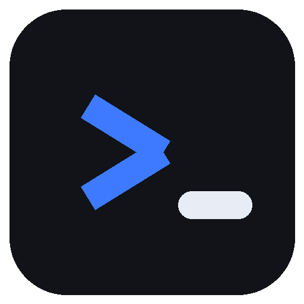
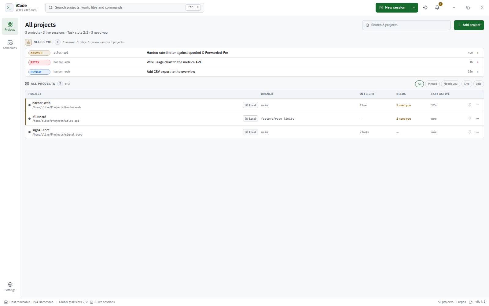
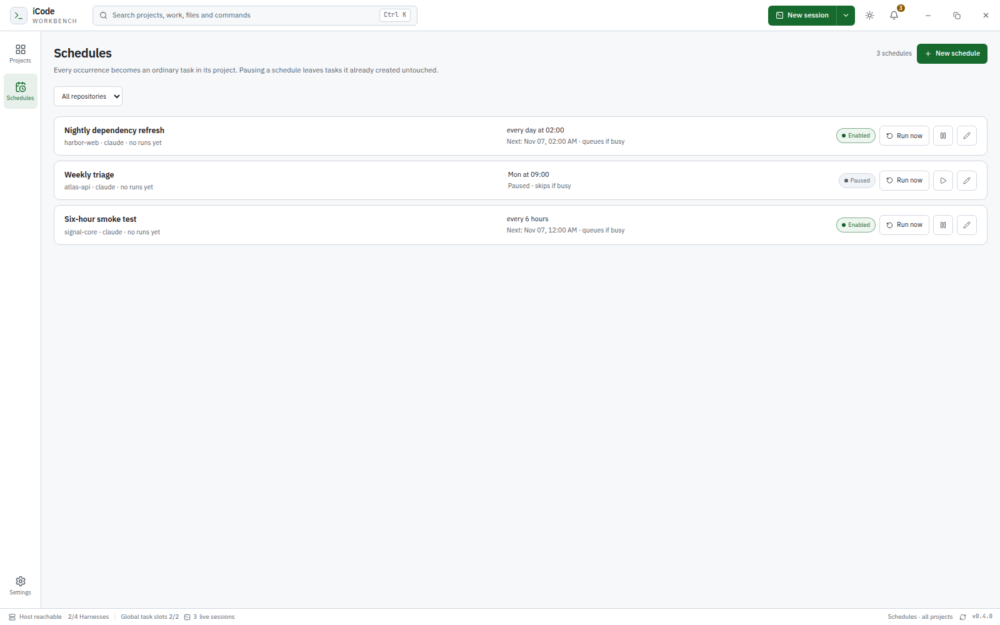
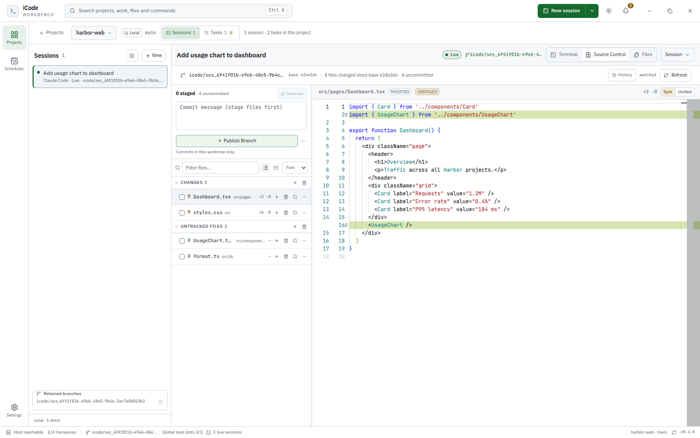
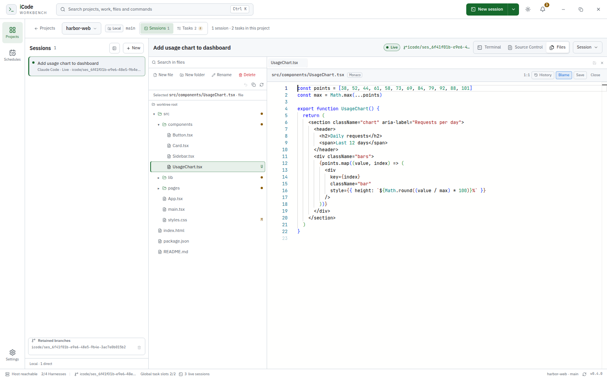
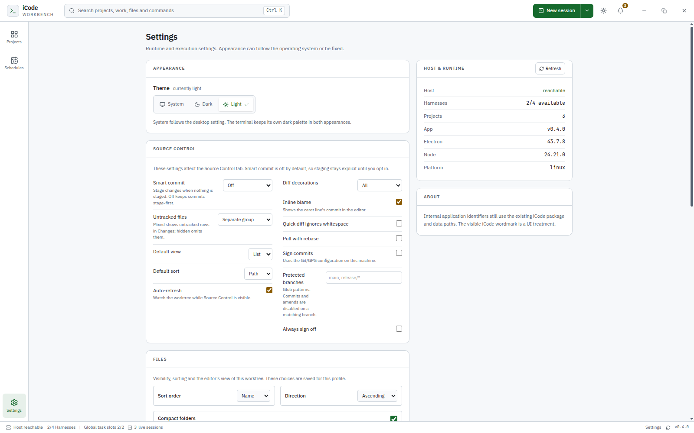

<h1 align="center">
   iCode
</h1>

<p align="center">
  <strong>The Agent Development Environment for local coding agents.</strong><br/>
  Run Claude Code, Codex, and OpenCode in parallel, each in its own Git worktree.
  Supervise every repository from one wall, review the diff, and keep the terminal
  alive when the app restarts.
</p>

<h3 align="center"><a href="#install"><ins>Get started</ins></a></h3>

<p align="center">
  
</p>

<p align="center">
  <sub>Pre-1.0 · Linux (WSL2/WSLg) · Windows x64 · macOS x64 / arm64</sub>
</p>

## Features

### One wall for every project

The Projects wall is the operational view. Each row separates three questions
that a terminal mixes together: **In flight** shows live direct sessions plus
running and queued tasks; **Needs** aggregates setup failures, tasks waiting for
an answer, failed tasks to retry, completed tasks awaiting review, and direct
agents waiting for input; **Last active** uses agent, task, and setup timestamps
rather than summary refresh time. Filter by Needs you, Live, or Idle, pin
projects, and open a waiting task or session directly from the attention list.

### Isolated sessions by default

Every new session gets its own Git worktree and branch at the current HEAD, so
two agents in the same repository never edit the same checkout. Restart a
session without moving its worktree; sleep a direct session to stop the process
while keeping the checkout and resume token; wake it to continue the harness
conversation where the harness supports it. Removal is guarded by live PTYs, host
reachability, uncommitted changes, unmerged commits, and missing worktrees; a
clean removal deletes the checkout and keeps the branch.

### Terminals that survive the app

A detached host owns the PTYs, terminal emulation, and exit truth. Closing the
window or quitting iCode does not stop a live session; reopening the app
reattaches to the same PTY incarnation. Attach returns a serialized snapshot with
scrollback and alternate-screen state, and flow control keeps a slow UI from
blocking the agent's process.

<p align="center">
  <a href=".github/assets/session-terminal.png"></a>
</p>

*A real PTY in the session worktree; the detached host keeps it alive. The
terminal keeps its own dark palette in both appearances.*

### Attention, not terminal scraping

Claude Code hooks report session start, prompts, tool calls, permission requests,
and turn endings. iCode turns those events into `Working · <tool>`, `Needs you`,
`Done`, and `Done · failed`, with unread markers and OS notifications only when
no window is focused. Activity is advisory: it never changes process state, and a
relaunch resets it to `unknown` rather than showing stale work. Only Claude Code
reports activity today; Codex, OpenCode, and shell sessions stay `unknown` by
design.

### Tasks and schedules

Tasks are durable units of work, not terminal tabs. Queue work with a global 1–4
slot limit; statuses move through `queued`, `dispatching`, `running`, `waiting`,
`completed`, `failed`, and `cancelled`. A retry is a new attempt; cancellation
leaves the worktree for inspection; the workbench shows the instruction, live
session, changes against the task baseline, and a review decision separate from
process exit. Schedules create ordinary queued tasks on a cadence — once, daily,
weekdays, weekly, or every few hours — with queue-or-skip overlap handling and
run-now.

<p align="center">
  <a href=".github/assets/tasks.png"></a>
</p>

*Task workbench: the instruction, the live session, changes against the task
baseline, and a review decision.*

<p align="center">
  <a href=".github/assets/schedules.png"></a>
</p>

*Recurring tasks with queue-or-skip overlap handling.*

### Review where the agent worked

Source Control is scoped to the session's checkout. **Changes** shows conflicts,
staged, unstaged, untracked, and commits made in this session; diffs are
area-scoped; stage or unstage by file, folder, hunk, or line; discard by file,
folder, or hunk; and a three-way merge editor handles conflicts. Add notes to
exact changed lines and send them back to the agent's terminal. Commit, commit
all tracked changes, amend, commit & push, pull, push, sync, or publish the
current branch, with paginated history and cherry-pick, revert, and reset
actions. Draft a commit message with the installed harness in one-shot mode; the
result only fills the draft.

<p align="center">
  <a href=".github/assets/session-review.png"></a>
</p>

*Review, stage, and commit in the session worktree.*

<p align="center">
  <a href=".github/assets/history.png"></a>
</p>

*Commit history, scoped to the current branch or the session.*

### Edit in the same checkout

Open Files beside the terminal and work in the same worktree the agent is
editing. The explorer supports create, rename, delete, duplicate, and move, with
app-managed trash and undo; Monaco provides editing, quick diffs against HEAD,
inline blame, and file history. Search the workspace, quick-open files, handle
external changes with reload/keep, and keep unsaved buffers across an ordinary
restart through hot exit.

<p align="center">
  <a href=".github/assets/files-editor.png"></a>
</p>

*Files and Monaco beside the terminal, in the same worktree.*

### Run where your code lives

Repositories can target this machine or a WSL distro. Local sessions run on
Linux, macOS, or native Windows over ConPTY; WSL agent sessions run on a managed
guest host reached through a relay, and shell sessions open through `wsl.exe`.
Harness detection is tri-state and target-aware, so a CLI installed on Windows
but missing inside the distro is reported correctly.

### Local-first, no cloud dependency

State is local: SQLite holds projects, sessions, worktrees, tasks, and schedules;
a detached host owns terminal truth; there is no telemetry and no hosted service.
iCode does not call model APIs — your harness does — and the renderer is
sandboxed behind a typed preload and validated IPC.

**Also in the box:**

- **Command palette**: `Ctrl/Cmd+K` for projects, sessions, tasks, and Source
  Control actions; `Ctrl/Cmd+P` for quick open.
- **Themes**: light by default, with System and Dark available, applied before
  first paint.
- **Configurable workflow**: task concurrency, Source Control, and Files
  preferences.
- **Session diagnostics**: host authority, PTY incarnation, worktree state, exit
  codes, and orphan terminal reporting.
- **Retained branches**: iCode-owned branches survive session removal; deletion
  is separate and requires the exact name when unmerged.
- **Native window chrome**: native traffic lights on macOS; custom controls on
  Windows and Linux.

<p align="center">
  <a href=".github/assets/settings.png"></a>
</p>

*Settings for appearance, task concurrency, Source Control, and Files.*

## How it works

1. **Add a project.** Register an existing Git checkout, or initialize a folder
   on its first commit. Repositories can live on this machine or inside a WSL
   distro.
2. **Start a session or queue a task.** A session launches immediately; a queued
   task starts when a slot is free. Either way, iCode creates a worktree on branch
   `icode/ses_<sessionId>` at the current HEAD and launches the harness in a real
   PTY.
3. **Work in the terminal.** Open Files and Source Control beside it. Both are
   tied to the same worktree the agent is editing.
4. **Review.** Stage by file, folder, hunk, or line; send line notes to the agent;
   commit, amend, and push when the result is ready.
5. **Finish safely.** Removing a session stops the PTY, blocks on uncommitted or
   unmerged work, and keeps the branch even when the checkout is removed.

> **iCode is the environment, not the agent.** It does not call model APIs or
> answer permission prompts. Your harness keeps its TUI, credentials, and
> permissions; you keep the decisions.

## Supported harnesses

Works with the coding-agent CLIs you already use. iCode runs the harness itself,
not a chat reimplementation, so its TUI, permissions, and hooks keep working.

<p>
  <kbd>Claude Code</kbd> &nbsp;
  <kbd>Codex</kbd> &nbsp;
  <kbd>OpenCode</kbd> &nbsp;
  <kbd>Shell</kbd>
</p>

Detection is tri-state and target-aware: available, unavailable after a real
probe, or a retryable detection failure. A tool installed on Windows but missing
inside a WSL distro is reported correctly.

## Install

iCode is pre-1.0. CI produces installers for Linux x64, Windows x64, and macOS
x64 / arm64; until releases are published, build from source.

### From source

**Requirements:** Node 24.x (`.nvmrc` pins 24.15.0), Corepack with pnpm 11.16.0,
Git, and at least one harness on `PATH`. Linux also needs `build-essential` and
`python3`; macOS needs Xcode Command Line Tools.

```bash
git clone https://github.com/LoongLab/iCode.git
cd iCode
corepack enable
pnpm install
pnpm dev
```

Then choose **Add project**, start a session, and work in the terminal.
`pnpm install` rebuilds `node-pty` against Electron's ABI on Linux; Windows and
macOS use Node-API prebuilds.

### Packages

| Platform | Artifacts |
|---|---|
| **Linux x64** | AppImage, deb, rpm |
| **Windows x64** | NSIS installer |
| **macOS x64 / arm64** | dmg, zip |

```bash
pnpm package:linux         # AppImage, deb, rpm
pnpm package:win           # NSIS; run on Windows
pnpm package:mac -- --x64
pnpm package:mac -- --arm64
```

Windows packaging requires the verified WSL host artifact tree at
`artifacts/wsl-host/linux-x64`. CI builds it once on Linux and passes it to the
Windows job; locally, `pnpm build:wsl-host` requires Docker. Linux and macOS
packages never ship that tree.

Artifacts are unsigned unless signing credentials are configured, so Windows
SmartScreen and macOS Gatekeeper warnings are expected.

On Linux, the unpacked build runs with `./dist/linux-unpacked/icode`. Its profile
is `$XDG_CONFIG_HOME/iCode` (default `~/.config/iCode`), with the database at
`icode.sqlite` and host runtime files under `run/`. Quitting the window leaves
the host and its PTYs alive.

## Community & support

- **Issues:** [github.com/LoongLab/iCode/issues](https://github.com/LoongLab/iCode/issues)
- **Contributing:** [.github/CONTRIBUTING.md](.github/CONTRIBUTING.md)
- **Changelog:** [CHANGELOG.md](CHANGELOG.md)
- **Privacy:** iCode has no telemetry, no hosted service, and makes no model API
  calls. Model traffic belongs to your harness.

## Current limits

iCode is pre-1.0. These boundaries are deliberate and worth knowing before you
adopt it:

- **Activity is Claude Code only.** Codex, OpenCode, and shell sessions report
  `unknown`. Task completion for non-Claude harnesses may rely on process exit.
- **Tasks are supervised, not autonomous.** Dispatch starts the real interactive
  harness and types the prompt. iCode does not answer permission prompts, so a
  waiting task still needs you.
- **Schedules need iCode running.** They are in-process timers, not a background
  daemon. Catch-up after a long shutdown is bounded to 24 hours.
- **Source Control is worktree-scoped.** It covers commit, amend, history, and
  current-branch remotes. It does not manage stashes, tags, submodules, or
  arbitrary branch checkouts.
- **The task list is bounded.** The shell loads up to 200 tasks.
- **Builds are unsigned.** Signing and notarization require credentials, and
  auto-update is not implemented.

## Developing

See [.github/CONTRIBUTING.md](.github/CONTRIBUTING.md) for prerequisites,
repository layout, compatibility gates, packaging, and the versioning convention.

Before sending a change:

```bash
pnpm typecheck
pnpm test
pnpm check:brand
pnpm build
```

<details>
<summary><strong>Engineering deep dive</strong></summary>

### Repository layout

| Path | Responsibility |
|---|---|
| `src/main` | Electron main: windows, gates, persistence, host supervisor/client |
| `src/host` | Detached terminal host: PTYs, NDJSON protocol, token auth |
| `src/preload` | Frozen typed bridge; context isolation on, Node off, sandbox on |
| `src/renderer` | Terminal workspace and product UI |
| `src/shared` | Domain model, Zod boundary contracts, host protocol |
| `config` | TypeScript, Vitest, electron-builder, build scripts |
| `tests/compat` | Compatibility gates and packaged smokes |
| `tests/wsl` | WSL host artifact selftests and smokes |

### Terminal host and continuity

`createOrAttach` is idempotent by durable session ID. A live session attaches; an
exited session restarts with a **new PTY incarnation**; attach-only never spawns.
Every write, resize, data event, and exit event carries both the durable session
ID and the incarnation, so a stale handle cannot touch a restarted PTY.

Each session runs a headless xterm fed by PTY output. Attaching waits for the
emulator to drain, then returns a serialized snapshot with dimensions, cursor,
sequence, alternate-screen state, up to 5,000 lines of scrollback, and a
`truncated` flag when history was lost. Snapshots are capped at 3 MiB. Alternate
screen content round-trips through the serialize addon.

Output feeds the emulator before clients, so a slow UI never blocks the process.
If the parse backlog exceeds 1 MiB, the PTY is paused and resumed below 256 KiB.
Per-client queues are capped at 1 MiB; excess data events become one `lagged`
notice with a sequence range. Responses are never dropped.

The socket prefers `$XDG_RUNTIME_DIR/icode/<profile-scope>/terminal-host.sock`,
with `ICODE_HOST_SOCKET` and `ICODE_HOST_DIR` as overrides. Authentication uses a
32-byte token in a `0600` file, a versioned hello, and constant-time comparison.
The host verifies effective `0700/0600` permissions and refuses filesystems that
cannot enforce them. A non-socket at the socket path is never deleted.

### Persistence and recovery

`app.getPath('userData')/icode.sqlite` is opened by the main process with
`node:sqlite`: WAL, foreign keys, `busy_timeout=5000`, and `synchronous=NORMAL`,
all verified on open. Migrations are append-only and each runs in its own
transaction.

The database refuses a zero-byte file, checks the SQLite header before opening,
and runs `PRAGMA integrity_check` read-only and again on the writable handle. On
failure it reports `DB_CORRUPT` with recovery guidance and never deletes,
renames, or recreates the file.

Startup reconciles stored sessions against the host. A persisted `live` is never
treated as proof; host query failure yields `unavailable`, not `exited`. A live
host PTY with no durable row is reported as an orphan rather than silently
adopted. Repository removal asks the host first and refuses while affected PTYs
are live or the host is unreachable.

### Worktree removal rules

All rules are re-checked at the moment of the action:

| Situation | Result |
|---|---|
| Live or starting PTY | Blocked |
| Host unreachable | Blocked; everything preserved |
| Uncommitted changes | Blocked; files listed |
| Unmerged commits | Blocked; commit count shown |
| Missing or unregistered worktree | Blocked; explicit recovery only |
| Clean and merged | Checkout removed, **branch retained** |

Session creation is refused for an unborn repository or while a merge, rebase,
cherry-pick, revert, or bisect is in progress, because no trustworthy baseline
exists. iCode never falls back to the primary checkout for a session whose
worktree is missing.

### Activity hooks

| Hook | Activity |
|---|---|
| `SessionStart` | `idle` |
| `UserPromptSubmit`, `PreToolUse`, `PostToolUse*` | `working` (tool name shown) |
| `PermissionRequest` | `waiting`, unread |
| `PreToolUse` of `AskUserQuestion` / `ExitPlanMode` | `waiting`, unread |
| `Stop` / `StopFailure` | `idle` with `completed` / `failed` |

Events from a previous incarnation are rejected. Events older than the newest
accepted event by more than 250 ms are rejected, and a `Stop` whose prompt ID is
not the current turn is rejected. Duplicate deliveries are idempotent.
`Notification` is intentionally not used because its interactive behavior was
not verified.

The hook script drains Claude's payload from stdin, forwards one bounded JSON
object over a Unix socket, writes nothing to stdout, and exits `0` within 100 ms
even when iCode is down. A broken iCode must never block the agent.

### Security model

- The renderer is sandboxed with context isolation and Node disabled. The preload
  exposes named operations only; subscriptions are reference-counted and dispose
  individually.
- Main registers a fixed IPC channel table, validates each payload with Zod,
  checks the calling frame, and maps failures to stable `AppError` codes.
- The host protocol is NDJSON with a 4 MiB frame limit; malformed, oversized,
  unknown, and identity-colliding frames are rejected.
- Agent workspace trust for new worktrees is pre-seeded for Claude and Codex.
  iCode never answers a harness permission prompt on your behalf.

</details>

## License

[MIT](LICENSE) © iCode contributors.

Third-party notices are in [NOTICE](NOTICE). Release notes live in
[CHANGELOG.md](CHANGELOG.md).
