<h1 align="center">
   iCode Workbench
</h1>

<p align="center">
  <strong>English</strong> ·
  <a href="README.zh-CN.md">简体中文</a> ·
  <a href="README.ja.md">日本語</a> ·
  <a href="README.ko.md">한국어</a> ·
  <a href="README.es.md">Español</a> ·
  <a href="README.pt-BR.md">Português (BR)</a> ·
  <a href="README.de.md">Deutsch</a> ·
  <a href="README.fr.md">Français</a>
</p>

<p align="center">
  <sub><strong>THE UNIVERSAL AGENT DEVELOPMENT ENVIRONMENT (ADE)</strong></sub><br/>
  <strong>Every agent. Every platform. One workbench.</strong><br/>
  Today: Claude Code, Codex, and OpenCode in parallel, each in its own Git worktree.
  Mira, your cross-project assistant, watches every repository, tells you what
  needs you, and can act across them. Review the diff, and keep the terminal
  alive when the app restarts.
</p>

<h3 align="center"><a href="#install"><ins>Get started</ins></a></h3>

<p align="center">
  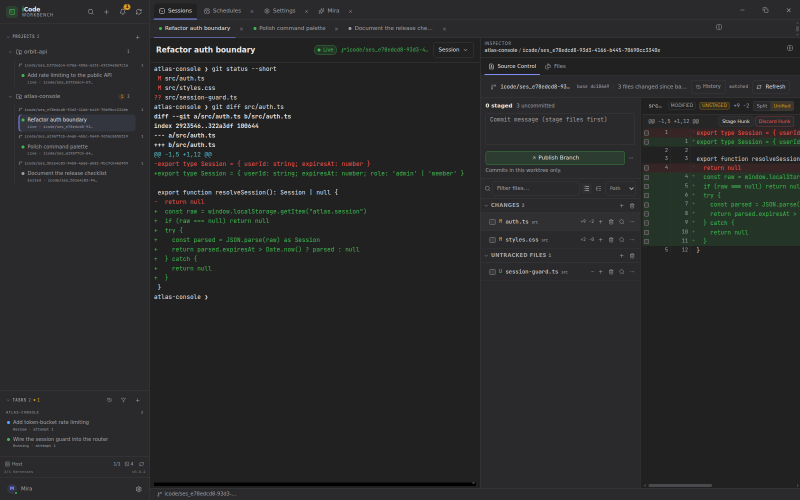
</p>

<p align="center">
  <sub>Pre-1.0 · Linux (WSL2/WSLg) · Windows x64 · macOS x64 / arm64</sub>
</p>

## Why iCode Workbench?

iCode Workbench is the control room for a team of coding agents. It turns the
terminal into a portfolio: each agent works in an isolated worktree, each task
has a durable record, and every change is reviewed in the checkout where it was
made.

- **Every agent, one workbench.** Claude Code, Codex, and OpenCode today; the
  adapter model is built to add more harnesses.
- **Every platform.** Linux (WSL2/WSLg), Windows x64, and macOS x64 / arm64.
- **One sidebar, two surfaces.** Projects, direct sessions, pinned items and the
  cross-project task queue share one sidebar. Sessions and task workbenches are
  the main surfaces; Mira, Settings and Schedules are temporary app tabs.
- **Parallel by default.** Every session gets its own branch and Git worktree;
  keep several in sight with session tabs and a resizable split view.
- **Review in place.** Source Control and Files live in a persistent inspector
  beside the terminal, or in the task workbench for queued work.
- **Mira across projects.** One conversation for the real queue, blockers, and
  cross-project actions.
- **Terminals that outlive the app.** A detached host owns the PTYs, so closing
  the window does not stop the agents.

## Features

### One sidebar, two surfaces

The sidebar is the only navigation and the portfolio view. Its top row holds
search, new work, notifications and refresh. **Pinned** projects, sessions and
tasks are shortcuts above the complete **Projects** tree, not replacements for
it. A project row expands to its direct sessions, grouped by worktree branch,
with state and agent activity on each row. Task-owned sessions never appear
there.

The **Tasks** section at the bottom is the cross-project queue, grouped by
project and ordered by attention. It has separate **Needs** and **History**
views, and a task can be pinned without leaving the queue. The sidebar footer
keeps host status, task slots, live session count, harness count and app version
in view; Mira and Settings sit below it.

The main column has two work surfaces:

- **Sessions** — one tab per direct session, a resizable split view, and a
  persistent Source Control/Files inspector on the right. A compact strip under
  the terminal carries branch, ahead/behind, conflicts and caret blame.
- **Task workbench** — Overview, Terminal, Source Control and Files for one task,
  selected from the sidebar rather than opened as a tab.

Sessions is the base surface, pinned first whenever the app-tab strip is visible.
Opening Mira, Settings or Schedules adds a temporary tab beside it; closing the
last auxiliary tab returns to Sessions. A task workbench is never an app tab. The
project menu holds new session, queue task, pin, copy path, repository settings,
**Sessions & branches**, and remove. Before the first repository, the main column
is just the welcome card and **Add project**.

The shell adapts rather than shrinking the terminal forever. Below 1280px the
inspector collapses to a rail; below 900px the sidebar becomes a drawer and an
expanded inspector overlays the workspace instead of taking layout width. Focus
mode (`F11`, or `Ctrl/Cmd+J` outside the terminal) drops the sidebar, app tabs,
session or task header, inspector and window chrome, leaving only the terminal.

### Meet Mira, your cross-project assistant

Mira opens from the sidebar footer, or from **Talk to Mira** in the command
palette, as an auxiliary tab. The Sessions tab stays pinned beside her, and the
sidebar keeps the working set visible while she answers. She is not scoped to
one project, and she is not a terminal: one conversation spans every repository.

- **She can see the work.** Projects, tasks, sessions, review state and diffs are
  in her context, so “what needs me?” is answered from the real queue rather than
  a summary you have to assemble.
- **She can act across projects.** Through validated actions she creates,
  cancels, retries, resumes and archives tasks, messages task sessions and
  project supervisors, records non-binding review recommendations, and remembers
  durable preferences. She has no shell, no project working directory, and cannot
  approve a proposal, decide a review, merge or push.
- **She streams.** With Claude Code, replies render as Markdown while they are
  written; the run line shows the current stage, elapsed time and thinking-token
  count, and Stop terminates the harness — on Windows, its whole shim process
  tree.
- **She keeps the harness’s conversation.** The installed harness owns the native
  conversation and Mira resumes it by session id. The header lists the current
  and earlier conversations, and each loads its part of the transcript. **New
  conversation** starts a clean one; switching harness or target starts a bridged
  conversation with a visible boundary, and a failed resume falls back to a
  bridged conversation rather than losing the thread.
- **She comes to you.** Approvals, failed or waiting tasks, review-ready work and
  completed Mira/supervisor tasks become proactive messages with a sidebar unread
  badge, an app-tab badge when Mira is open, and an OS notification when no
  window is focused. They stay in the notifications drawer rather than
  cluttering the conversation. Deduplication, an hourly budget and quiet hours
  keep it from becoming noise.

<p align="center">
  <a href=".github/assets/workbench-mira.png">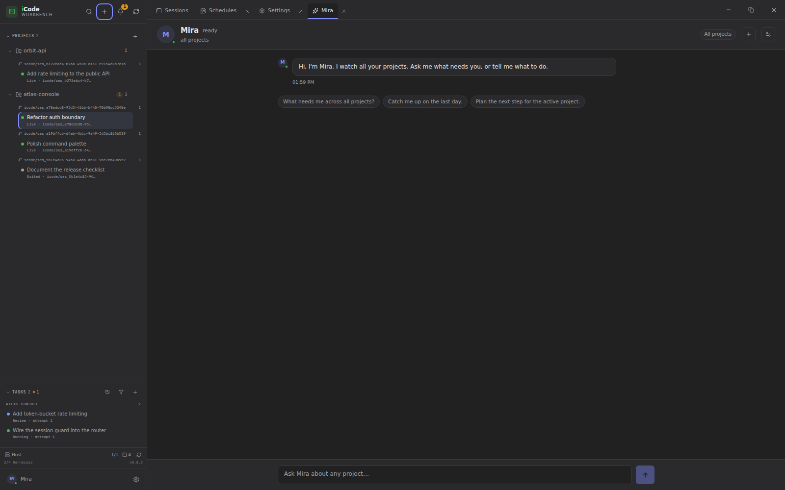</a>
</p>

*Mira opens beside the pinned Sessions tab. The sidebar keeps projects, sessions
and the task queue visible while she answers; unread messages surface on the
sidebar button and on her app tab.*

Mira is configured in **Settings → Mira**: persona name, run target (this machine,
a WSL distro, or auto), preferred harness, auto-dispatch policy, and notification
policy. Markdown is rendered as React nodes — headings, lists, tables, code,
quotes and http(s) links — never as raw HTML. Low-risk tasks she creates may
auto-dispatch under a daily cap and protected-path/keyword policy; everything else
waits for a person.

### Isolated sessions by default

Every direct session gets its own Git worktree and a new branch, starting from
the current branch or one you choose, so two agents in the same repository never
edit the same checkout. Open sessions
appear as tabs above the workspace; drag them to reorder, right-click for
**Close**, **Close other tabs**, **Close tabs to the right** or **Split right**,
and resize the divider to rebalance the two panes. Restart a session without
moving its worktree; sleep a direct session to stop the process while keeping the
checkout and resume token; wake it to continue the harness conversation where
the harness supports it.

Session removal is guarded by live PTYs, host reachability, uncommitted changes,
unmerged commits, and missing worktrees; a clean removal deletes the checkout
and keeps the branch. The **Sessions & branches** dialog in the project menu
lists retained branches and any terminals the host still owns, and branch
deletion is a separate action.

<p align="center">
  <a href=".github/assets/workbench-session-split.png">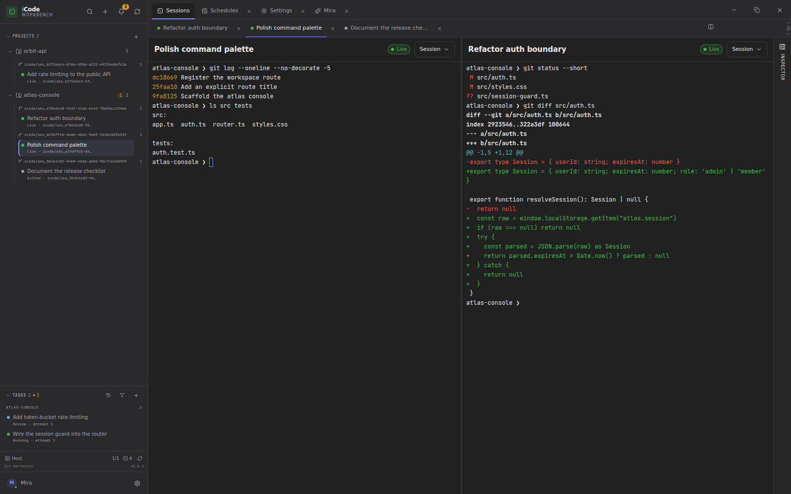</a>
</p>

*Two direct sessions side by side. The divider is resizable and each pane keeps
its own PTY; the inspector collapses to give the terminals more room.*

### Terminals that survive the app

A detached host owns the PTYs, terminal emulation, and exit truth. Closing the
window or quitting iCode does not stop a live session; reopening the app
reattaches to the same PTY incarnation. A tab switch or split only changes what
is visible; every pane stays attached to its own process. Attach returns a
serialized snapshot with scrollback and alternate-screen state, and flow control
keeps a slow UI from blocking the agent's process.

<p align="center">
  <a href=".github/assets/workbench-session-terminal.png">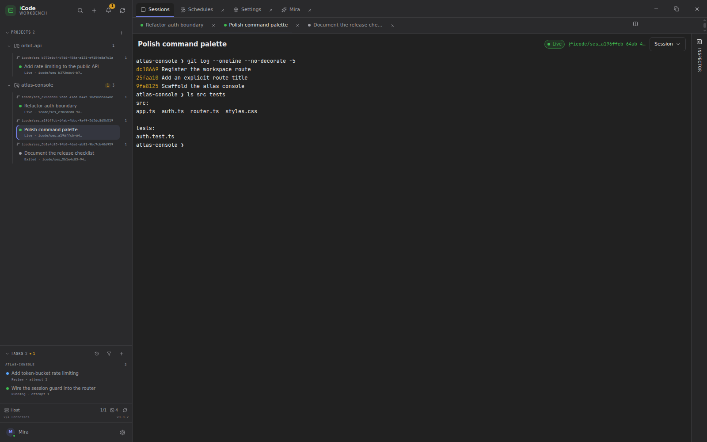</a>
</p>

*A real PTY in the session worktree; the detached host keeps it alive. The tab
strip switches the visible session, while the collapsed inspector leaves room
for the terminal.*

### Attention, not terminal scraping

Claude Code hooks report session start, prompts, tool calls, permission requests,
and turn endings. iCode turns those events into `Working · <tool>`, `Needs you`,
`Done`, and `Done · failed`. The sidebar row carries the activity line and
unread emphasis; OS notifications fire only when no window is focused. Activity
is advisory: it never changes process state, and a relaunch resets it to
`unknown` rather than showing stale work. Only Claude Code reports activity
today; Codex, OpenCode, and shell sessions stay `unknown` by design. Task-linked
sessions do not raise a second OS notification: Mira owns the blocker message,
and the activity stream stays the raw evidence.

### Tasks, approvals, schedules, and chains

Tasks are durable units of work, not terminal tabs. Selecting a task replaces the
main surface with its workbench; the workbench is never an app tab, and a
task-owned session never appears under a project or in the session tab strip.

Queue work under two limits: how many tasks run at once globally (1–4) and how
many run at once per project (1–4). Statuses move through `queued`,
`dispatching`, `running`, `waiting`, `completed`, `failed`, and `cancelled`. A
retry is a new attempt; resume continues a failed or cancelled attempt in its
existing session and worktree; cancellation leaves the worktree for inspection.
The workbench shows the instruction, live session, changes against the task
baseline, and a review decision separate from process exit.

Approval depends on who asked. Your own tasks are approved when queued and start
when a slot is free. A project supervisor always proposes for a person, and a
Mira-created task waits unless the current auto-dispatch policy permits it. That
policy is deliberately conservative: daily caps (three per project and ten
globally by default), protected keywords and protected paths all keep the gate
closed.

Dependencies form chains. A dependent waits for its blockers to complete, and for
a blocker’s acceptance when **Wait for my acceptance before dependent tasks
start** is set. Chain tasks also share a chain branch: the dependent does not
dispatch until the blocker’s work has been merged into that branch. This makes
review and merge ordering explicit instead of hoping two agents finish in the
right order. A project supervisor is a control session bound to one repository;
it proposes tasks from that project’s own context, always waits for a human
decision, and stays in the project’s Sessions. Mira can start or message one for
you.

Review accept/reject is a human decision. Accepting records the judgment; it does
not merge, push or delete anything. Merge remains in Source Control, where
**Accept & merge…** is an explicit second step for a task result.

Schedules create ordinary queued tasks on a cadence — once, daily, weekdays,
weekly, or every few hours — with queue-or-skip overlap handling and run-now.

<p align="center">
  <a href=".github/assets/workbench-tasks.png">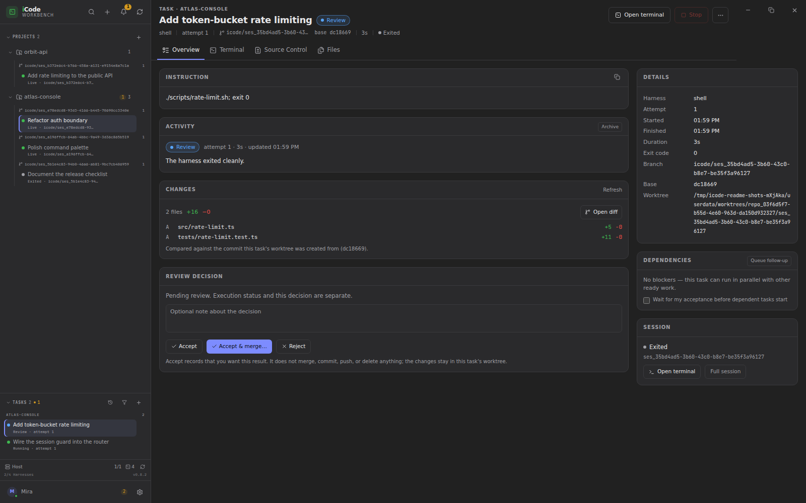</a>
</p>

*Task workbench: the instruction, the session, changes against the task
baseline, and a review decision. The sidebar stays on the project and its queue.*

<p align="center">
  <a href=".github/assets/workbench-schedules.png">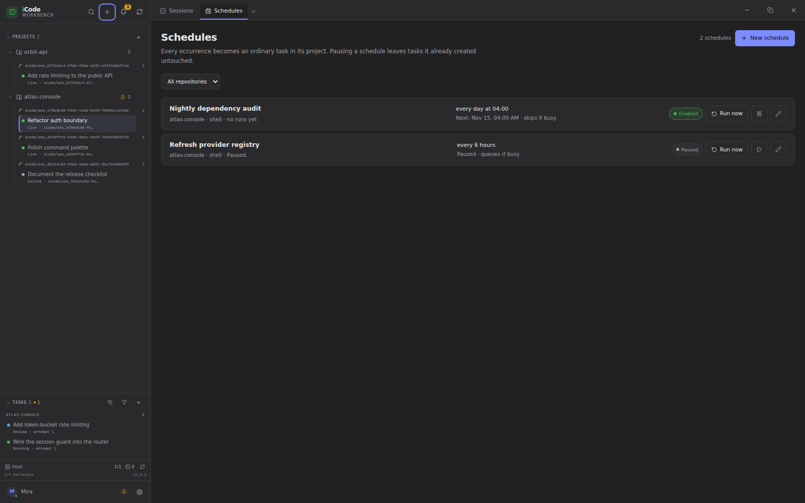</a>
</p>

*Recurring tasks with queue-or-skip overlap handling. Schedules open as an
auxiliary tab and create ordinary queued tasks.*

<p align="center">
  <a href=".github/assets/workbench-task-composer.png">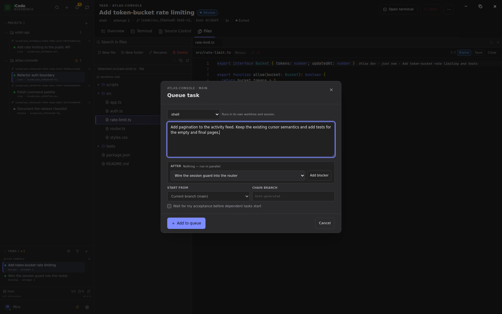</a>
</p>

*Queue unattended work with a harness, optional blockers, a start point and a
chain branch. The new task joins the same sidebar queue.*

### Task history, without the clutter

The Tasks section defaults to the working list. **Needs** narrows it to work
waiting on a person: proposals to approve, sessions waiting for an answer,
failed tasks to retry, completions pending review, and chains blocked by a
dead-end blocker. **History** switches the same section to archived tasks.

Archive or restore a task from its Overview or the task actions menu. Archiving
is reversible and does not delete the review, session, worktree or retry chain.
Reviewed completions and cancellations are archived automatically after seven
days; review-pending completions and failures stay in the working list. Retry
chains collapse to the latest attempt, and earlier attempts remain
under **Previous attempts**. Archived tasks are excluded from attention counts,
Mira’s context and notifications, but remain queryable as history. There is
deliberately no hard-delete action.

<p align="center">
  <a href=".github/assets/workbench-task-history.png">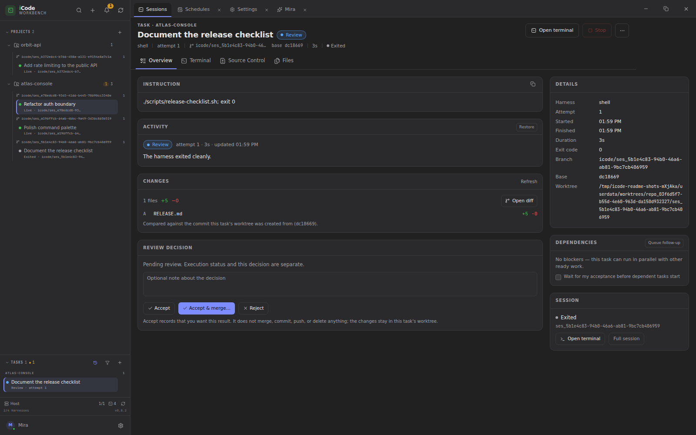</a>
</p>

*History keeps finished work out of the working list while preserving the task,
its attempts and its review record.*

### Review where the agent worked

Source Control is scoped to the session's checkout and lives in the persistent
inspector, or in a task's full-width Source Control tab. The task Overview also
summarizes changes against the baseline and opens the full diff. Diffs are
area-scoped; stage or unstage by file, folder, hunk, or line; discard by file,
folder, or hunk; and a three-way merge editor handles conflicts. Add notes to
exact changed lines and send them back to the agent's terminal. Commit, commit
all tracked changes, amend, commit & push, pull, push, sync, or publish the
current branch, with paginated history and cherry-pick, revert, and reset
actions. Draft a commit message with the installed harness in one-shot mode; the
result only fills the draft.

<p align="center">
  <a href=".github/assets/workbench-task-review.png">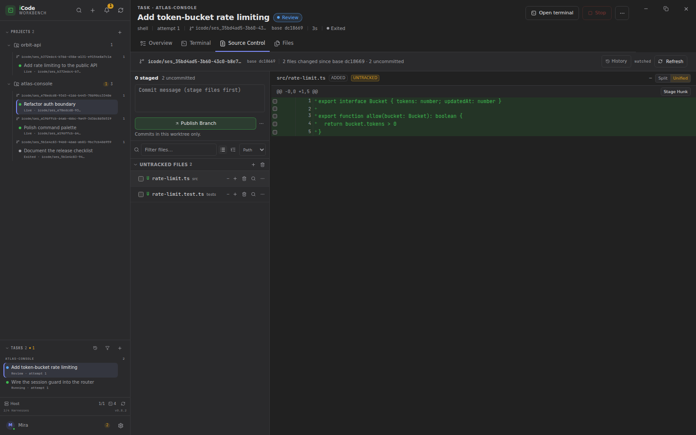</a>
</p>

*Review, stage, and commit in the task's worktree. The full-width Source Control
tab keeps the file list and diff readable.*

<p align="center">
  <a href=".github/assets/workbench-history.png">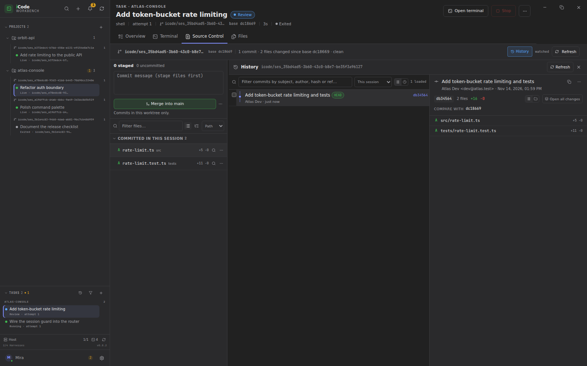</a>
</p>

*Commit history, scoped to the task's session and its chain branch.*

### Edit in the same checkout

Open Files beside the terminal (or in a task's Files tab) and work in the same
worktree the agent is editing. The explorer supports create, rename, delete,
duplicate, and move, with app-managed trash and undo; Monaco provides editing,
quick diffs against HEAD, inline blame, and file history. Search the workspace,
quick-open files, handle external changes with reload/keep, and keep unsaved
buffers across an ordinary restart through hot exit.

<p align="center">
  <a href=".github/assets/workbench-files-editor.png">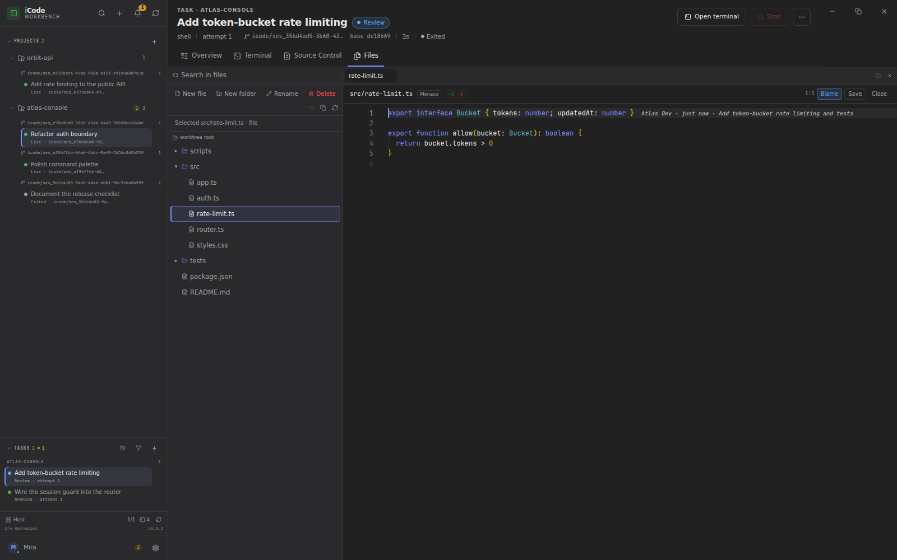</a>
</p>

*Files and Monaco in the task's worktree. The explorer and editor keep their
full width in the task surface; the session inspector uses the same panel beside
the terminal.*

### Run where your code lives

Repositories can target this machine or a WSL distro. Local sessions run on
Linux, macOS, or native Windows over ConPTY; WSL agent sessions run on a managed
guest host reached through a relay, and shell sessions open through `wsl.exe`.
Harness detection is tri-state and target-aware, so a CLI installed on Windows
but missing inside the distro is reported correctly.

### Local-first, no cloud dependency

State is local: SQLite holds projects, sessions, worktrees, tasks, and schedules;
a detached host owns terminal truth; there is no telemetry and no hosted service.
iCode does not call model APIs — your harness does — and the renderer is
sandboxed behind a typed preload and validated IPC.

**Also in the box:**

- **Session tabs and split view**: browser-style tab menus, drag reordering,
  and a resizable two-pane split.
- **Focus mode**: `F11` or `Ctrl/Cmd+J` leaves only the terminal.
- **Pinned working set**: pin projects, sessions and tasks as sidebar
  shortcuts; the project tree stays complete.
- **Project onboarding**: open an existing checkout, clone from a URL with live
  progress, or initialize a folder’s first commit; repositories can live locally
  or inside a WSL distro.
- **Repository settings**: add, edit, fetch and remove Git remotes from the
  project menu.
- **Sessions & branches**: retained branches and orphan terminal reporting from
  the project menu.
- **Instant project removal**: the row disappears immediately while cleanup
  stops sessions, snapshots dirty worktrees and reports retry/discard in the
  sidebar footer.
- **Command palette**: `Ctrl/Cmd+K` for projects, sessions, tasks, Source
  Control actions, and “Talk to Mira”; `Ctrl/Cmd+P` for quick open.
- **Mira settings**: persona, local/WSL/auto target, preferred harness,
  auto-dispatch policy, notifications and quiet hours.
- **Task history**: archive/restore, collapsed retry attempts, and seven-day
  retention for reviewed completions and cancellations.
- **Themes**: light by default, with System and Dark available, applied before
  first paint.
- **Configurable workflow**: global and per-project task concurrency, Source
  Control, and Files preferences.
- **Session diagnostics**: host authority, PTY incarnation, worktree state, and
  exit codes in Session details.
- **Retained branches**: iCode-owned branches survive session removal; deletion
  is separate and requires the exact name when unmerged.
- **Native window chrome**: native traffic lights on macOS; custom controls on
  Windows and Linux.

<p align="center">
  <a href=".github/assets/workbench-settings.png">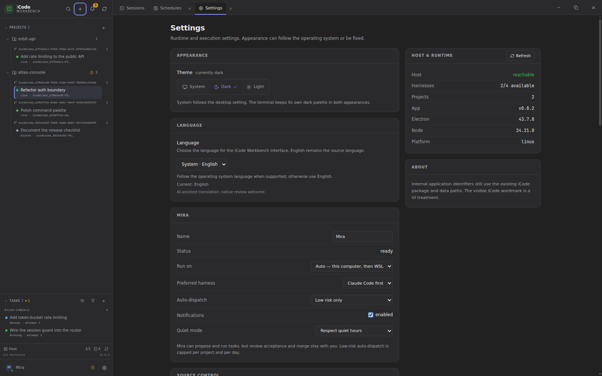</a>
</p>

*Settings open as an auxiliary tab. Appearance, language, Mira, task execution,
Source Control, Files, agent providers, harnesses, host/runtime and About share
one page.*

## How it works

1. **Add a project.** Register an existing Git checkout, clone from a URL, or
   initialize a folder on its first commit. Repositories can live on this
   machine or inside a WSL distro.
2. **Start work.** From the sidebar, open a project and start a direct session,
   queue a task, or open Mira. A direct session launches immediately; a queued
   task waits for a global and per-project slot. Either way, iCode creates a
   worktree and branch at the chosen start point and launches the harness in a
   real PTY.
3. **Approve or adjust the plan.** Your own tasks are approved on creation.
   Supervisor proposals wait for a person, and Mira tasks wait unless the
   auto-dispatch policy allows them to start. Blockers and chain branches decide
   when dependents may start.
4. **Work in the terminal.** Switch sessions with the tab strip, split when two
   need to be visible, and open Source Control or Files in the inspector. Every
   pane is tied to the same worktree the agent is editing.
5. **Review.** Stage by file, folder, hunk, or line; send line notes to the
   agent; accept a task review when the result is right. Accept does not merge.
   When the result should land, merge from Source Control; for a chain, merge
   each blocker into the shared chain branch so its dependents can dispatch.
6. **Archive the finished work.** Archive reviewed completions and cancellations
   as you go; those older than seven days are archived automatically. A retry
   chain stays one row with its attempts preserved.
7. **Finish safely.** Removing a project is instant: the row disappears and a
   background cleanup job stops its sessions, snapshots dirty worktrees to
   recovery refs, and reports progress with Retry/Discard in the sidebar footer.
   Removing an individual session still stops the PTY, blocks on uncommitted or
   unmerged work, and keeps the branch even when the checkout is removed.

> **iCode is the environment, not the agent.** It does not call model APIs or
> answer permission prompts. Your harness keeps its TUI, credentials, and
> permissions; you keep the decisions.

## Supported harnesses

Works with the coding-agent CLIs you already use. iCode runs the harness itself,
not a chat reimplementation, so its TUI, permissions, and hooks keep working.

<p>
  <kbd>Claude Code</kbd> &nbsp;
  <kbd>Codex</kbd> &nbsp;
  <kbd>OpenCode</kbd> &nbsp;
  <kbd>Shell</kbd>
</p>

Detection is tri-state and target-aware: available, unavailable after a real
probe, or a retryable detection failure. A tool installed on Windows but missing
inside a WSL distro is reported correctly.

Mira uses the same installed CLI in a one-shot mode in a scratch directory on
this machine or inside a WSL distro. All three agent harnesses can resume their
own native conversation by session id; a harness or target switch starts a
bridged conversation with a visible boundary. Claude Code supplies
token-by-token streaming; Codex and OpenCode currently report run stages and the
final reply rather than a live text draft.

## Install

Download the latest installer from the
[Releases page](https://github.com/icodehq/icode-workbench/releases/latest).
CI builds each release from its tagged commit:

| Platform | Download |
|---|---|
| **Linux x64** | AppImage, deb, or rpm |
| **Windows x64** | NSIS installer (`.exe`) |
| **macOS x64 / arm64** | dmg or zip |

The installers are unsigned, so Windows SmartScreen and macOS Gatekeeper warn on
first launch. On macOS, right-click the app and choose **Open** to allow it.
iCode is pre-1.0; features and storage schemas may still change between releases.

### From source

**Requirements:** Node 24.x (`.nvmrc` pins 24.15.0), Corepack with pnpm 11.16.0,
Git, and at least one harness on `PATH`. Linux also needs `build-essential` and
`python3`; macOS needs Xcode Command Line Tools.

```bash
git clone https://github.com/icodehq/icode-workbench.git
cd icode-workbench
corepack enable
pnpm install
pnpm dev
```

Then choose **Add project**, start a session, queue a task, or open **Mira** and
ask what needs you.
`pnpm install` rebuilds `node-pty` against Electron's ABI on Linux; Windows and
macOS use Node-API prebuilds.

### Packages

| Platform | Artifacts |
|---|---|
| **Linux x64** | AppImage, deb, rpm |
| **Windows x64** | NSIS installer |
| **macOS x64 / arm64** | dmg, zip |

```bash
pnpm package:linux         # AppImage, deb, rpm
pnpm package:win           # NSIS; run on Windows
pnpm package:mac -- --x64
pnpm package:mac -- --arm64
```

Windows packaging requires the verified WSL host artifact tree at
`artifacts/wsl-host/linux-x64`. CI builds it once on Linux and passes it to the
Windows job; locally, `pnpm build:wsl-host` requires Docker. Linux and macOS
packages never ship that tree.

Artifacts are unsigned unless signing credentials are configured, so Windows
SmartScreen and macOS Gatekeeper warnings are expected.

On Linux, the unpacked build runs with `./dist/linux-unpacked/icode`. Its profile
is `$XDG_CONFIG_HOME/iCode` (default `~/.config/iCode`), with the database at
`icode.sqlite` and host runtime files under `run/`. Quitting the window leaves
the host and its PTYs alive.

### Troubleshooting

- **Windows: iCode exits immediately and `--version` prints a Node version.**
  If iCode is started from an AI terminal or automation tool that exports
  `ELECTRON_RUN_AS_NODE=1`, Electron runs the executable as plain Node instead
  of the app: no window appears, the exit code is 0, and there is no iCode log.
  Clear the variable before launching (`Remove-Item Env:ELECTRON_RUN_AS_NODE`
  in PowerShell, `set ELECTRON_RUN_AS_NODE=` in cmd), or start iCode from the
  Start menu. The app cannot log this itself, because Electron never reaches
  application code in that mode.
- **Checking the database schema version.** `icode.sqlite` runs in WAL mode; a
  migration committed by a running app lives in `icode.sqlite-wal` until a clean
  quit checkpoints it. A tool that reads only the main file, or a copy without
  its `-wal` and `-shm` companions, can report the previous `user_version` and
  miss recently added tables. Quit iCode normally before inspecting the profile,
  or inspect the whole directory.

## Community & support

- **Issues:** [github.com/icodehq/icode-workbench/issues](https://github.com/icodehq/icode-workbench/issues)
- **Contributing:** [.github/CONTRIBUTING.md](.github/CONTRIBUTING.md)
- **Code of Conduct:** [CODE_OF_CONDUCT.md](CODE_OF_CONDUCT.md)
- **Security:** [SECURITY.md](SECURITY.md)
- **Translations:** [TRANSLATIONS.md](TRANSLATIONS.md)
- **Changelog:** [CHANGELOG.md](CHANGELOG.md)
- **Privacy:** iCode has no telemetry, no hosted service, and makes no model API
  calls. Model traffic belongs to your harness.

## Developing

See [.github/CONTRIBUTING.md](.github/CONTRIBUTING.md) for prerequisites,
repository layout, compatibility gates, packaging, and the versioning convention.

Before sending a change:

```bash
pnpm typecheck
pnpm test
pnpm check:brand
pnpm build
```

<details>
<summary><strong>Engineering deep dive</strong></summary>

### Repository layout

| Path | Responsibility |
|---|---|
| `src/main` | Electron main: windows, gates, persistence, host supervisor/client |
| `src/host` | Detached terminal host: PTYs, NDJSON protocol, token auth |
| `src/preload` | Frozen typed bridge; context isolation on, Node off, sandbox on |
| `src/renderer` | Terminal workspace and product UI |
| `src/shared` | Domain model, Zod boundary contracts, host protocol |
| `config` | TypeScript, Vitest, electron-builder, build scripts |
| `tests/compat` | Compatibility gates and packaged smokes |
| `tests/wsl` | WSL host artifact selftests and smokes |

### Mira: native conversation, typed control plane

Mira is not a repo-less PTY. Each turn is a one-shot run of the same installed
harness in a scratch directory on this machine or inside a WSL distro. The
harness owns the native conversation: iCode stores the opaque session id, while
the harness keeps the prior context. A manual **New conversation** retires the
handle and starts clean. A harness or target switch, or a failed resume, retires
it and starts a bridged conversation: the next turn replays a compact recent
history and appends a visible boundary to the thread, so the switch is not
amnesia.

Every turn rebuilds the persona and cross-project snapshot; a per-turn digest
carries action results, failures and notifications from turns the harness did
not see. The model answers with one JSON envelope. Main validates it with Zod
and executes reads before writes; up to three harness calls are allowed per
turn. Writes are authorized and audited in `assistant_actions`; the model never
gets a project working directory, a shell, or a control socket. Approvals,
review decisions, merges and deletes are absent from its action vocabulary.

Claude runs with `--output-format stream-json`: text deltas feed a Markdown
draft, thinking-token events feed the run line, and the final `result` event is
captured as it arrives. Codex and OpenCode are resumed through their own
session ids but report run stages and the final reply rather than a live draft.
Low-risk auto-dispatch is a conservative policy over daily caps, protected
keywords and protected paths; the default is three per project and ten globally.
Notifications use a per-thread sequence watermark and a partial unique dedupe
key, so restarts and repeated task events do not replay the same message.

### Terminal host and continuity

`createOrAttach` is idempotent by durable session ID. A live session attaches; an
exited session restarts with a **new PTY incarnation**; attach-only never spawns.
Every write, resize, data event, and exit event carries both the durable session
ID and the incarnation, so a stale handle cannot touch a restarted PTY.

Each session runs a headless xterm fed by PTY output. Attaching waits for the
emulator to drain, then returns a serialized snapshot with dimensions, cursor,
sequence, alternate-screen state, up to 5,000 lines of scrollback, and a
`truncated` flag when history was lost. Snapshots are capped at 3 MiB. Alternate
screen content round-trips through the serialize addon.

Output feeds the emulator before clients, so a slow UI never blocks the process.
If the parse backlog exceeds 1 MiB, the PTY is paused and resumed below 256 KiB.
Per-client queues are capped at 1 MiB; excess data events become one `lagged`
notice with a sequence range. Responses are never dropped.

The socket prefers `$XDG_RUNTIME_DIR/icode/<profile-scope>/terminal-host.sock`,
with `ICODE_HOST_SOCKET` and `ICODE_HOST_DIR` as overrides. Authentication uses a
32-byte token in a `0600` file, a versioned hello, and constant-time comparison.
The host verifies effective `0700/0600` permissions and refuses filesystems that
cannot enforce them. A non-socket at the socket path is never deleted.

### Persistence and recovery

`app.getPath('userData')/icode.sqlite` is opened by the main process with
`node:sqlite`: WAL, foreign keys, `busy_timeout=5000`, and `synchronous=NORMAL`,
all verified on open. Migrations are append-only and each runs in its own
transaction.

The database refuses a zero-byte file, checks the SQLite header before opening,
and runs `PRAGMA integrity_check` read-only and again on the writable handle. On
failure it reports `DB_CORRUPT` with recovery guidance and never deletes,
renames, or recreates the file.

Startup reconciles stored sessions against the host. A persisted `live` is never
treated as proof; host query failure yields `unavailable`, not `exited`. A live
host PTY with no durable row is reported as an orphan rather than silently
adopted. Repository removal is optimistic and durable: the project row
disappears first while a background job stops live PTYs, snapshots dirty
worktrees to `refs/icode/removed/*`, and removes the checkout. An unreachable
host moves the job to `waiting_host` instead of blocking the action, and the
sidebar cleanup indicator exposes Retry and Discard snapshots.

### Session removal rules

The following rules apply when removing a single session; they are re-checked at
the moment of the action:

| Situation | Result |
|---|---|
| Live or starting PTY | Blocked |
| Host unreachable | Blocked; everything preserved |
| Uncommitted changes | Blocked; files listed |
| Unmerged commits | Blocked; commit count shown |
| Missing or unregistered worktree | Blocked; explicit recovery only |
| Clean and merged | Checkout removed, **branch retained** |

Session creation is refused for an unborn repository or while a merge, rebase,
cherry-pick, revert, or bisect is in progress, because no trustworthy baseline
exists. iCode never falls back to the primary checkout for a session whose
worktree is missing.

### Activity hooks

| Hook | Activity |
|---|---|
| `SessionStart` | `idle` |
| `UserPromptSubmit`, `PreToolUse`, `PostToolUse*` | `working` (tool name shown) |
| `PermissionRequest` | `waiting`, unread |
| `PreToolUse` of `AskUserQuestion` / `ExitPlanMode` | `waiting`, unread |
| `Stop` / `StopFailure` | `idle` with `completed` / `failed` |

Events from a previous incarnation are rejected. Events older than the newest
accepted event by more than 250 ms are rejected, and a `Stop` whose prompt ID is
not the current turn is rejected. Duplicate deliveries are idempotent.
`Notification` is intentionally not used because its interactive behavior was
not verified.

The hook script drains Claude's payload from stdin, forwards one bounded JSON
object over a Unix socket, writes nothing to stdout, and exits `0` within 100 ms
even when iCode is down. A broken iCode must never block the agent.

### Security model

- The renderer is sandboxed with context isolation and Node disabled. The preload
  exposes named operations only; subscriptions are reference-counted and dispose
  individually.
- Main registers a fixed IPC channel table, validates each payload with Zod,
  checks the calling frame, and maps failures to stable `AppError` codes.
- Mira’s Markdown renderer produces React elements, never HTML. Only http(s)
  links can reach `shell.openExternal`; `file:`, `javascript:` and custom schemes
  are rejected in both the parser and the IPC handler.
- The host protocol is NDJSON with a 4 MiB frame limit; malformed, oversized,
  unknown, and identity-colliding frames are rejected.
- Agent workspace trust for new worktrees is pre-seeded for Claude and Codex.
  iCode never answers a harness permission prompt on your behalf.

</details>

## Status

iCode Workbench is in early experimental development and iterating quickly.
Features, storage schemas, and packaging may change between releases. Use normal
Git hygiene on real work, and check the [changelog](CHANGELOG.md) before
upgrading; every user-visible change is recorded there.

## Star History

<p align="center">
  <a href="https://www.star-history.com/?repos=icodehq%2Ficode-workbench&type=date&legend=top-left">
    <picture>
      <source media="(prefers-color-scheme: dark)" srcset="https://api.star-history.com/chart?repos=icodehq/icode-workbench&type=date&theme=dark&legend=top-left" />
      <source media="(prefers-color-scheme: light)" srcset="https://api.star-history.com/chart?repos=icodehq/icode-workbench&type=date&legend=top-left" />
      
    </picture>
  </a>
</p>
