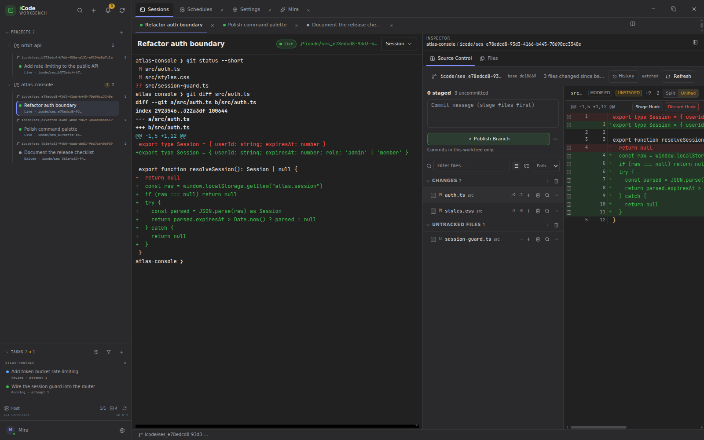

# iCode Workbench

<p align="center">
  <a href="README.md">English</a> ·
  <strong>简体中文</strong> ·
  <a href="README.ja.md">日本語</a> ·
  <a href="README.ko.md">한국어</a> ·
  <a href="README.es.md">Español</a> ·
  <a href="README.pt-BR.md">Português (BR)</a> ·
  <a href="README.de.md">Deutsch</a> ·
  <a href="README.fr.md">Français</a>
</p>

<h3 align="center">所有智能体。所有平台。一个工作台。</h3>

<p align="center">
  iCode Workbench 是通用的智能体开发环境（ADE）：Claude Code、Codex 和 OpenCode
  可以并行运行，每个会话都拥有独立的 Git 工作树。Mira 跨项目观察所有仓库，告诉你
  什么需要你处理，并能在项目之间执行操作。在智能体工作的地方审查改动，并让终端在
  应用重启后继续运行。
</p>

<p align="center">
  
</p>

## 为什么选择 iCode Workbench？

- **一个工作台，支持所有智能体。** 今天支持 Claude Code、Codex 和 OpenCode；
  适配器模型可以继续接入更多 harness。
- **支持所有平台。** Linux（WSL2/WSLg）、Windows x64、macOS x64 / arm64。
- **默认并行。** 每个会话都有独立的分支和 Git 工作树。
- **跨项目的 Mira。** 一个对话覆盖任务队列、阻塞事项和跨项目操作。
- **在智能体工作的地方审查。** 任务 diff、源代码管理和 Monaco 编辑器都在同一个
  session checkout 中。
- **一个侧边栏掌握全部工作。** 项目、直连会话、置顶项和跨项目任务队列始终可见；Mira、设置和计划以标签页打开。

## 当前支持

- **智能体：** Claude Code、Codex、OpenCode
- **平台：** Linux（WSL2/WSLg）、Windows x64、macOS x64 / arm64

## 从源码构建

```bash
git clone https://github.com/icodehq/icode-workbench.git
cd icode-workbench
corepack enable
pnpm install
pnpm dev
```

## 状态

iCode Workbench 处于早期实验阶段，迭代很快。功能、存储结构和打包方式可能随版本
变化。请在真实项目中使用正常的 Git 工作习惯，并在升级前查看
[更新日志](CHANGELOG.md)。

> 这是翻译概览。英文版 README 是权威来源；完整细节以
> [English README](README.md) 为准。

[English README](README.md) · [参与贡献](.github/CONTRIBUTING.md) ·
[安全政策](SECURITY.md) · [更新日志](CHANGELOG.md)
